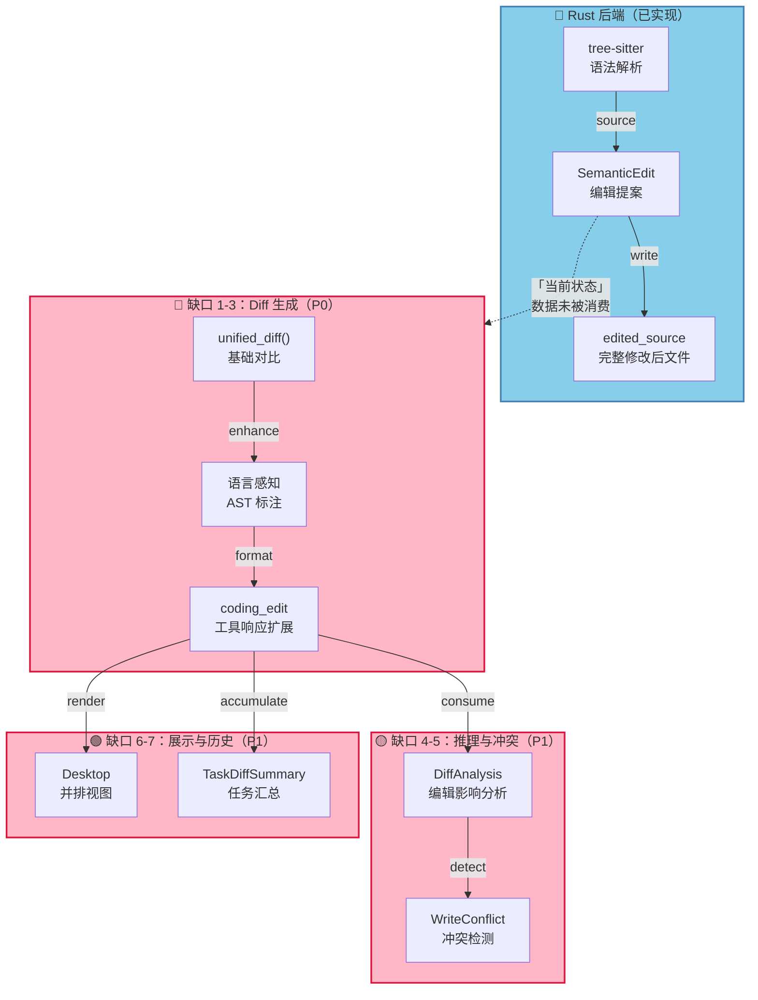
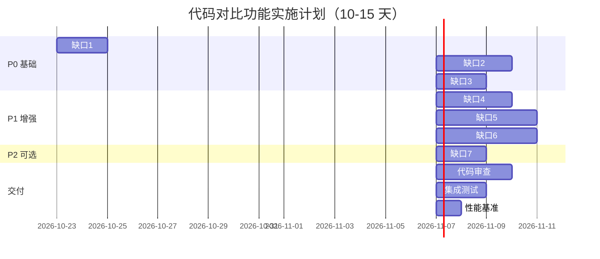

# 代码对比功能：实施路线与责任矩阵

## 一、架构与数据流



---

## 二、时间线与团队责任



---

## 三、缺口分解与工作项

### 🔴 P0：Diff 生成引擎（Week 1）

#### 缺口 1：统一 Diff 生成（2 天）

**目标**：生成 unified diff，对标 GNU diff -u

| 工作项 | 所有者 | 输入 | 输出 | 验收 |
|--------|--------|------|------|------|
| 集成 `similar` crate | Backend Team | Cargo.toml | 依赖就位 | `cargo build` 通过 |
| 实现 `unified_diff()` 函数 | Backend Team | before, after | `Vec<DiffBlock>` | 回归 100+ 用例 |
| 编写单元测试集 | QA Team | 测试用例库 | src/diff/tests.rs | 覆盖率 ≥95% |
| 性能基准测试 | Perf Team | 1KB-100MB 文件 | 延迟数据 | P50 < 50ms |
| 文档与注释 | Backend Team | 代码 | README | 新人可理解 |

**交付物**：
```rust
// worldbase_coding/src/diff.rs
pub fn unified_diff(before: &str, after: &str, context: usize) 
    -> Result<Vec<DiffBlock>>
```

---

#### 缺口 2：语义 Diff（3 天）

**目标**：为 diff 行附加 AST 节点类型和语法高亮

| 工作项 | 所有者 | 输入 | 输出 | 验收 |
|--------|--------|------|------|------|
| 复用 tree-sitter 解析结果 | Backend Team | ParsedFile | AST 节点映射 | 位置对齐 |
| 为 DiffLine 扩展 `LanguageAwareDiffLine` | Backend Team | DiffLine + ParsedFile | 带 node_kind、highlight 的行 | 无运行时错误 |
| 实现 Syntax Highlighter（快速路径） | Backend Team | tokens | `Vec<Token>` | P50 < 10ms |
| 写语言特定测试（TS/Py/Rust/Go） | QA Team | 样本代码 | 回归套件 | 各语言 ≥10 用例 |

**交付物**：
```rust
pub struct LanguageAwareDiffLine {
    pub base: DiffLine,
    pub node_kind: Option<String>,
    pub is_formatting_only: bool,
}
```

---

#### 缺口 3：API 扩展（2 天）

**目标**：`coding_edit` 工具支持返回结构化 diff

| 工作项 | 所有者 | 输入 | 输出 | 验收 |
|--------|--------|------|------|------|
| 工具参数扩展：`diffFormat`, `contextLines` | Backend Team | 请求参数定义 | schema.json | 兼容旧请求 |
| 响应字段扩展：`diff.blocks`, `diff.stats` | Backend Team | SemanticEdit | JSON 响应 | 与测试数据对标 |
| 集成路径：在 `execute_edit()` 中调用 Diff 函数 | Backend Team | 现有响应逻辑 | 完整响应 | E2E 测试通过 |
| 文档与示例 | Doc Team | API 定义 | docs/coding-edit-diff-api.md | 新开发者可使用 |

**交付物**：
```json
{
  "changed": true,
  "diff": {
    "format": "unified",
    "blocks": [...],
    "stats": { "additions": 1, "deletions": 1 }
  }
}
```

---

### 🟡 P1：推理与冲突（Week 2）

#### 缺口 4：Diff 分析（3 天）

**目标**：Agent 能从 diff 推测编辑影响

| 工作项 | 所有者 | 输入 | 输出 | 验收 |
|--------|--------|------|------|------|
| 实现 `DiffAnalysis` 结构 | Backend Team | SemanticEdit + ProjectIndex | affected_symbols, severity | 无 panic |
| 提取受影响符号（调用符号表） | Backend Team | DiffBlock + SymbolIndex | `Vec<String>` | ≥90% 准确率 |
| 估计跨文件影响（保守策略） | Backend Team | affected_symbols + ImportGraph | cross_file_impact | 误报率 ≤10% |
| 集成到编码循环 | Agent Team | DiffAnalysis | Agent 推理输入 | Agent 能读取和响应 |

**交付物**：
```rust
pub struct DiffAnalysis {
    pub affected_symbols: Vec<String>,
    pub change_severity: Severity,
    pub cross_file_impact: Vec<String>,
}
```

---

#### 缺口 5：冲突检测（4 天）

**目标**：并行编辑时检测冲突

| 工作项 | 所有者 | 输入 | 输出 | 验收 |
|--------|--------|------|------|------|
| 定义 `ConflictType` 枚举 | Backend Team | 需求文档 | 类型定义 | 涵盖所有已知冲突 |
| 实现行级冲突检测 | Backend Team | 多个 SemanticEdit | `Vec<WriteConflict>` | 测试用例全过 |
| 实现符号级冲突检测 | Backend Team | SymbolIndex + edits | 包含依赖信息 | 误报率 ≤5% |
| 在 `spawn_subagents` 前调用 | Parallel Team | subagent 写入计划 | 冲突报告 | 阻止危险并行 |

**交付物**：
```rust
pub fn detect_conflicts(edits: &[SemanticEdit], project: &ProjectIndex) 
    -> Result<Vec<WriteConflict>>
```

---

### 🟢 P1：展示与历史（Week 3）

#### 缺口 6：UI 展示（4 天）

**目标**：用户和 Agent 能看到编辑对比

| 工作项 | 所有者 | 输入 | 输出 | 验收 |
|--------|--------|------|------|------|
| 设计 Desktop 并排视图组件 | UI/UX Team | diff 数据结构 | 交互设计文档 | PM 评审通过 |
| 实现 React 组件（Desktop） | Frontend Team | 设计稿 | CodeDiffView.tsx | 渲染性能 < 200ms |
| 支持 syntax highlight（JavaScript） | Frontend Team | DiffBlock + language | 带色彩的 diff | 各语言样式正确 |
| 集成到编码编辑器 | Frontend Team | 现有编辑器 | 并排显示 | 行号和选区对齐 |

**交付物**：React 组件 `<CodeDiff/>` 和集成

---

#### 缺口 7：历史汇总（2 天）

**目标**：任务级 diff 统计和对标

| 工作项 | 所有者 | 输入 | 输出 | 验收 |
|--------|--------|------|------|------|
| 实现 `TaskDiffSummary` 结构 | Backend Team | 任务中所有编辑 | 累积统计 | 无重复计算 |
| 计算编辑轮次和重复率 | Analytics Team | edits 序列 | `repeated_edit_rate` | ≤5% 误差 |
| 输出任务前后 diff | Backend Team | first + last SemanticEdit | 总体变化 | 与直接比较一致 |
| 集成到任务报告 | Agent Team | TaskDiffSummary | Agent 可读的摘要 | 用于后续对标 |

**交付物**：
```rust
pub struct TaskDiffSummary {
    pub cumulative_diff: Vec<DiffBlock>,
    pub stats: TaskDiffStats,
}
```

---

## 四、团队与技能要求

### Backend Team（Rust）
- ✅ tree-sitter 熟悉度
- ✅ 算法基础（diff 算法、图论）
- 工作量：18 人·天

### QA Team
- ✅ 测试设计和自动化
- ✅ 回归测试管理
- 工作量：8 人·天

### Frontend Team（TypeScript/React）
- ✅ 编辑器集成经验
- ✅ 性能优化
- 工作量：8 人·天

### Agent Team
- ✅ 编码循环逻辑
- ✅ 推理与决策集成
- 工作量：6 人·天

**总计**：40 人·天 ≈ 2-3 人，10-15 天

---

## 五、风险与缓解

| 风险 | 概率 | 影响 | 缓解 |
|------|------|------|------|
| Diff 算法性能（大文件） | 中 | 高 | 预先做性能基准；考虑流式处理 |
| 冲突检测误报率过高 | 中 | 中 | 保守策略（宁可串行）；充分测试 |
| 跨端 UI 差异（Mobile） | 低 | 中 | Dart 端暂不做 UI，仅返回 JSON |
| 现有工具兼容性破坏 | 低 | 高 | 新参数可选；向后兼容 |

---

## 六、验收检查清单

### 缺口 1-3 上线前（Week 1 End）

- [ ] `unified_diff()` 对标 GNU diff，偏差 < 1%
- [ ] 100+ 语言和编辑类型回归通过
- [ ] diff 生成性能 P50 < 50ms，P99 < 200ms
- [ ] `coding_edit` 工具响应包含 `diff` 字段
- [ ] API 文档完整，包含请求/响应示例
- [ ] 代码审查通过（≥2 人）

### 缺口 4-5 上线前（Week 2 End）

- [ ] `DiffAnalysis` 能推测编辑影响，准确率 ≥90%
- [ ] 冲突检测覆盖率 ≥95%，误报率 ≤5%
- [ ] 集成编码循环，Agent 能读取并决策
- [ ] 集成测试通过

### 缺口 6-7 上线前（Week 3 End）

- [ ] Desktop diff 视图响应 < 200ms
- [ ] 支持 TypeScript、Python、Rust、Go、Java
- [ ] 行号和列号对齐，无偏移错误
- [ ] 任务汇总报告生成正确
- [ ] 全链路 E2E 测试通过

---

## 七、优化建议与后续迭代

### 立即可做（Week 2-3 并行）
- 缓存 diff 结果，避免重复计算
- 流式生成 diff（大文件不阻塞）
- 支持 git diff 格式输出

### 中期（Month 2）
- 3-way diff（三向合并）
- "仅显示 diff 影响的符号"快速导航
- Diff 驱动的自动化修复建议

### 长期（Month 3+）
- 基于 diff 历史的学习与预测
- "一键回滚到任意编辑前"
- 分布式 diff 缓存（多开发者协作）

---

## 八、成功指标

| 指标 | 目标 | 测量方法 |
|------|------|----------|
| Diff 覆盖率 | ≥95% 编辑都有 diff | 日志统计 |
| Agent 采用率 | ≥80% 编码任务使用 diff | 使用量 |
| 用户满意度 | ≥4.0/5.0 | 问卷调查 |
| 性能基线 | Diff 生成 < 50ms (P50) | 性能监控 |
| 冲突误报率 | ≤5% | 人工审核 |

---

**下一步**：
1. Week 1 Oct 23：Backend Team 启动缺口 1-3，每日同步
2. Week 1 Oct 26：代码审查与集成测试
3. Week 2 Oct 29：缺口 4-5 启动
4. Week 3 Nov 5：缺口 6-7 启动
5. Week 4 Nov 12：全面交付与文档

