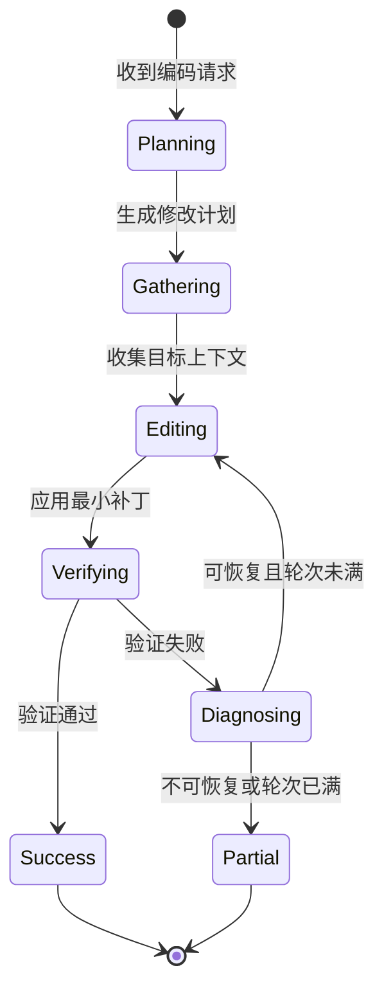

# WorldBase AI 编码能力升级 - 架构设计与实施指南 v2.0

**文档版本**：2.0（Rust Harness 单一运行时）  
**目标读者**：开发工程师、架构师  
**实施状态**：设计提案；除“当前基线”外，模块均未实现  
**最后更新**：2026-10-21

> **架构约束**：编码能力只在 Rust harness 内实现。Desktop、Mobile、CLI 均为客户端，通过现有 JSON-RPC 2.0 协议调用 harness；Mobile native 边界使用手写 `dart:ffi`。不得增加第二套编码引擎，也不得把关键逻辑放回客户端。

> **当前事实**：通用 Agent 循环已支持最多 128 步、上下文压缩、并行只读工具和并行子代理。Coding Loop、tree-sitter AST 编辑、Error Analyzer 和 LSP 集成都仍是提案，不是已交付能力。

---

## 📋 目录

1. [总体架构](#1-总体架构)
2. [核心模块设计](#2-核心模块设计)
3. [数据结构与接口](#3-数据结构与接口)
4. [实施路线图](#4-实施路线图)
5. [测试验收标准](#5-测试验收标准)
6. [部署与集成](#6-部署与集成)
7. [风险与应对](#7-风险与应对)
8. [附录](#8-附录)

---

## 1. 总体架构

### 1.1 设计原则

1. **单一运行时**：编码编排、工具执行、验证和会话存储全部位于 `harness-rs`。
2. **增量增强**：复用已有的 128 步通用循环、上下文压缩、并行只读工具与子代理，不复制循环。
3. **协议优先**：所有客户端通过 JSON-RPC 2.0 调用同一能力域；能力必须经过握手协商。
4. **权限一致**：文件读写、命令执行和网络访问统一经过 Rust 工具权限层。
5. **可观测与可取消**：计划、编辑、验证、诊断均产生事件，并响应取消信号与超时。
6. **事实与提案分离**：文档、UI 和验收清单明确标注已实现能力与设计目标。

### 1.2 系统分层

```text
┌──────────────────────────────────────────────────────┐
│ 客户端层：Desktop UI / Mobile UI / CLI                 │
├──────────────────────────────────────────────────────┤
│ 传输层：JSON-RPC 2.0（WebSocket / stdio / in-process） │
├──────────────────────────────────────────────────────┤
│ Rust Harness                                          │
│ ├─ worldbase-core：通用 Agent 循环（已实现）           │
│ │   ├─ 最多 128 步模型/工具循环                       │
│ │   ├─ 上下文压缩                                     │
│ │   ├─ 并行只读工具调度                               │
│ │   └─ 并行子代理                                     │
│ ├─ coding（提案）：编码计划、修复轮次、验证、诊断      │
│ │   ├─ Coding Loop Orchestrator                       │
│ │   ├─ Smart Editor                                   │
│ │   ├─ Error Analyzer                                 │
│ │   └─ Context Manager                                │
│ ├─ worldbase-tools：文件、搜索、命令、子代理（已实现） │
│ ├─ worldbase-protocol：RPC、事件与能力协商（已实现）   │
│ └─ worldbase-mobile-ffi：进程内 native 启动（已实现）  │
├──────────────────────────────────────────────────────┤
│ 存储层：会话 SQLite / 工作区缓存 / 可观测事件           │
└──────────────────────────────────────────────────────┘
```

Desktop 外壳只负责渲染与宿主能力，不持有编码状态机。Mobile 通过手写 FFI 启动进程内 harness，再连接其 loopback 服务。CLI 可直接使用 Rust library API，或作为 JSON-RPC 客户端运行。

### 1.3 技术栈

| 层级 | 技术选型 | 状态 | 理由 |
|------|----------|------|------|
| 通用循环 | Rust + Tokio | ✅ 已实现 | 统一调度、取消、超时和工具执行 |
| 上下文管理 | 现有压缩器 + 预算控制 | ✅ / 🧭 | 压缩已实现，编码专用选择策略待实现 |
| 并行工具 | Rust 异步任务 | ✅ 已实现 | 只读工具与子代理可并行 |
| RPC | JSON-RPC 2.0 + 事件 | ✅ 已实现 | Desktop、CLI、Mobile 共用协议 |
| AST 编辑 | tree-sitter（提案） | 🧭 提案 | 多语言语法树与容错解析 |
| 错误分析 | 规则 + 模型辅助（提案） | 🧭 提案 | 编译/测试错误归一化与修复建议 |
| 存储 | SQLite / `rusqlite` | ✅ / 🧭 | 已有会话基础，编码表结构待落地 |

---

## 2. 核心模块设计

### 2.1 Coding Loop Orchestrator（编码循环协调器）

**职责（提案）**：在通用 Agent 循环之上协调编码计划、修复轮次、验证与诊断，而不是替换 128 步执行循环。

#### 状态机设计



#### 核心算法（Rust 伪代码）

```rust
// 提案：编码层修复轮次。每次模型/工具执行仍受通用循环的 128 步上限约束。
async fn execute_coding_loop(
    request: CodingRequest,
    services: &CodingServices,
) -> Result<CodingResult> {
    let plan = services.planner.create_plan(&request).await?;
    let context = services
        .context
        .gather(&plan.required_files, &request.workspace_root)
        .await?;

    let mut last_failure = None;
    let mut changes = Vec::new();

    for repair_round in 1..=request.config.max_repair_rounds {
        let edits = services
            .editor
            .generate(&plan, &context, last_failure.as_ref())
            .await?;

        services
            .patch_applier
            .apply_checked(&request.workspace_root, &edits)
            .await?;
        changes.extend(edits);

        let verification = services
            .verification
            .verify(&plan.verification_steps)
            .await?;

        if verification.passed {
            return Ok(CodingResult::success(repair_round, changes));
        }

        let diagnosis = services
            .analyzer
            .diagnose(&verification.failure, &context)
            .await?;
        if !diagnosis.is_recoverable {
            return Ok(CodingResult::partial(repair_round, changes, diagnosis));
        }

        plan.apply_diagnosis(&diagnosis);
        last_failure = Some(verification.failure);
    }

    Ok(CodingResult::partial(
        request.config.max_repair_rounds,
        changes,
        services.analyzer.last_known_diagnosis(),
    ))
}
```

**执行边界**：

- `max_repair_rounds` 建议初始值为 3，可配置，但必须有硬上限。
- 通用 Agent 循环的 128 步上限仍然是全局安全边界；编码轮次不得重置或绕过该上限。
- 每次编辑前记录快照，验证失败时允许按策略回滚本轮的整组修改。
- 取消信号必须同时中止模型请求、工具调用和验证命令。

#### 接口定义

```rust
#[derive(Debug, Clone, Serialize, Deserialize)]
pub struct CodingRequest {
    pub user_prompt: String,
    pub project_id: Option<String>,
    pub workspace_root: PathBuf,
    pub context: CodingContext,
    pub config: CodingConfig,
}

#[derive(Debug, Clone, Serialize, Deserialize)]
pub struct CodingContext {
    pub open_files: Vec<PathBuf>,
    pub recent_edits: Vec<Edit>,
    pub compressed_summary: Option<String>,
}

#[derive(Debug, Clone, Serialize, Deserialize)]
pub struct CodingPlan {
    pub required_files: Vec<PathBuf>,
    pub target_files: Vec<FileEditIntent>,
    pub verification_steps: Vec<VerificationStep>,
    pub estimated_complexity: Complexity,
}

#[derive(Debug, Clone, Serialize, Deserialize)]
pub struct FileEditIntent {
    pub file_path: PathBuf,
    pub intent: String,
    pub edit_type: EditKind,
    pub dependencies: Vec<PathBuf>,
}

#[derive(Debug, Clone, Copy, Serialize, Deserialize)]
pub enum Complexity {
    Simple,
    Medium,
    Complex,
}

#[derive(Debug, Clone, Serialize, Deserialize)]
pub struct CodingResult {
    pub status: CodingStatus,
    pub repair_rounds: u32,
    pub changes: Vec<Edit>,
    pub diagnosis: Option<ErrorDiagnosis>,
    pub metrics: CodingMetrics,
}
```

---

### 2.2 Smart Editor（智能编辑器）

**职责（提案）**：把文件级编辑意图转换为最小、可验证的源代码补丁。没有可用 grammar 时，仍使用普通文本补丁，并明确标注该限制。

#### 核心能力

1. **语义定位**：通过 tree-sitter 查询函数、结构体、方法、导入等语法节点。
2. **增量编辑**：优先生成字节范围补丁，不重写整个文件。
3. **格式保持**：沿用原文件缩进、换行风格和相邻注释。
4. **写入校验**：应用补丁后重新解析，检查语法树是否出现新增错误节点。

#### 编辑策略选择

```text
输入：FileEditIntent、ParsedFile、最近一次验证失败
输出：EditStrategy

1. 新建文件                         -> CreateFile
2. 删除文件                         -> DeleteFile
3. 有明确目标节点且修改范围较小     -> SemanticReplace
4. 有稳定锚点且需要增量插入         -> InsertAfter / InsertBefore
5. 无 grammar 或修改范围超过阈值    -> TextPatch 或 FullRewrite
6. 任何策略都必须附带验证步骤和失败回滚条件
```

选择策略时不能只按“修改比例”判断。以下因素优先于比例：目标节点是否唯一、补丁是否能通过解析、是否跨越模块边界、是否改变公开 API。

#### AST 查询语言（简化版）

```rust
// 提案：选择器是内部类型，不暴露任意 grammar 细节给客户端。
let target = NodeSelector::new("function_item")
    .with_name("handle_request")
    .within(NodeSelector::new("impl_item").with_name("RequestHandler"));

let todos = NodeSelector::new("line_comment")
    .with_text_matches(r"TODO|FIXME");
```

查询结果必须包含：

- grammar 与语言版本；
- 文件路径和内容哈希；
- 节点字节范围与行列范围；
- 匹配数量与唯一性判定；
- 查询失败原因，供诊断与日志使用。

---

### 2.3 Error Analyzer（错误分析器，提案）

**职责**：把编译、测试和运行时错误转换为统一诊断，再生成可审计的修复建议。

#### 错误分类

```rust
#[derive(Debug, Clone, Copy, Serialize, Deserialize)]
pub enum ErrorCategory {
    Syntax,
    Type,
    Import,
    Runtime,
    Logic,
    Unknown,
}
```

#### 错误模式库（示例）

```rust
#[derive(Debug, Clone)]
pub struct ErrorPattern {
    pub id: &'static str,
    pub category: ErrorCategory,
    pub regex: &'static str,
    pub priority: u16,
    pub is_recoverable: bool,
    pub suggested_action: SuggestedAction,
}

const RUST_PATTERNS: &[ErrorPattern] = &[
    ErrorPattern {
        id: "rust_import_001",
        category: ErrorCategory::Import,
        regex: r"unresolved import `([^`]+)`",
        priority: 1,
        is_recoverable: true,
        suggested_action: SuggestedAction::InspectDependencies,
    },
    ErrorPattern {
        id: "rust_type_001",
        category: ErrorCategory::Type,
        regex: r"expected `([^`]+)`, found `([^`]+)`",
        priority: 2,
        is_recoverable: true,
        suggested_action: SuggestedAction::ReconcileTypes,
    },
    ErrorPattern {
        id: "rust_syntax_001",
        category: ErrorCategory::Syntax,
        regex: r"expected one of `([^`]+)`",
        priority: 1,
        is_recoverable: true,
        suggested_action: SuggestedAction::RepairSyntax,
    },
];
```

模式库必须版本化，并通过真实编译器/测试输出 fixture 回归。正则解析只是归一化入口，不应替代编译器诊断。

#### 诊断流程

```rust
impl ErrorAnalyzer {
    pub async fn diagnose(
        &self,
        failure: &VerificationFailure,
        context: &CodeContext,
    ) -> Result<ErrorDiagnosis> {
        let normalized = self.normalize(failure);

        if let Some(pattern) = self.match_pattern(&normalized) {
            let fix = self.suggest_fix(pattern, &normalized, context)?;
            self.record_pattern_usage(pattern.id).await?;
            return Ok(ErrorDiagnosis::from_pattern(pattern, fix));
        }

        let model_diagnosis = self
            .diagnose_with_model(&normalized, context)
            .await
            .context("模型辅助诊断失败")?;

        self.record_unknown_error(&normalized, &model_diagnosis)
            .await?;
        Ok(model_diagnosis)
    }
}
```

模型辅助诊断是处理未知错误的独立路径，必须有超时、输入长度上限、结构化输出校验和置信度。低置信度结果只能作为建议，不能自动写文件。

---

### 2.4 Context Manager（上下文管理器，提案）

**职责**：在已有压缩机制之上，为编码任务选择相关源码、依赖清单和验证输出，避免无关文件挤占预算。

#### 上下文收集策略

```rust
pub async fn gather_for_plan(
    plan: &CodingPlan,
    workspace: &Path,
) -> Result<CodeContext> {
    let mut files = plan.required_files.clone();

    // 1. 加入目标文件的直接依赖清单，而不是无限递归展开。
    files.extend(resolve_manifest_boundaries(&files, workspace).await?);

    // 2. 加入验证相关配置，例如 Cargo.toml、rust-toolchain.toml、clippy.toml。
    files.extend(find_verification_configs(workspace).await?);

    // 3. 复用只读工具并行读取，并经过工作区边界与忽略规则。
    let contents = tools.read_many_read_only(files, READ_CONCURRENCY).await?;

    // 4. 复用现有上下文压缩器，保留任务摘要、最近编辑与当前错误。
    compress_for_coding(contents, plan).await
}
```

**预算规则**：

- 优先保留目标文件、直接依赖、当前错误和最近相关编辑。
- 编译输出先结构化归一化，再按错误影响排序，不能直接塞入完整 stdout。
- 文件数、总字节数和压缩后 token 预算都必须有硬上限。
- 压缩摘要要保留文件路径、符号名、错误码和已验证结论。

---

### 2.5 Tool Executor（工具执行器，已实现 + 提案增强）

**当前已实现**：相互独立的只读工具调用可并行执行；子代理任务可并行分派并回收结果。写操作、命令执行和存在数据依赖的调用仍按安全顺序串行。

**提案增强**：为混合工具批次构建显式依赖图，只对已验证无依赖的节点并行调度。每次并行执行仍受全局并发上限、权限检查和取消信号约束。

```text
输入：同一批次中的 ToolCall 列表
输出：依赖分层与执行结果

1. 为每个调用建立节点，标记 read_only / mutating / external_side_effect。
2. 同一文件的 write/patch 依赖该文件之前的 read。
3. 构建/测试命令依赖本轮所有写操作完成。
4. 删除、重命名、网络写入和未知副作用默认串行。
5. 对 DAG 做拓扑分层；循环依赖立即报错。
6. 每层使用受限并发执行，失败结果交给上层 Aggregator。
```

---

## 3. 数据结构与接口

### 3.1 存储 Schema（提案）

#### Coding Session Store（SQLite）

```sql
CREATE TABLE coding_sessions (
  id TEXT PRIMARY KEY,
  user_id TEXT NOT NULL,
  project_id TEXT,
  workspace_root TEXT,
  user_prompt TEXT NOT NULL,
  status TEXT NOT NULL,
  repair_rounds INTEGER DEFAULT 0,
  agent_steps INTEGER DEFAULT 0,
  created_at INTEGER NOT NULL,
  updated_at INTEGER NOT NULL,
  completed_at INTEGER
);

CREATE TABLE coding_rounds (
  id TEXT PRIMARY KEY,
  session_id TEXT NOT NULL,
  round_number INTEGER NOT NULL,
  state TEXT NOT NULL,
  files_read INTEGER DEFAULT 0,
  files_modified INTEGER DEFAULT 0,
  verification_result TEXT,
  diagnosis_json TEXT,
  duration_ms INTEGER,
  created_at INTEGER NOT NULL,
  FOREIGN KEY (session_id) REFERENCES coding_sessions(id)
);

CREATE TABLE coding_edits (
  id TEXT PRIMARY KEY,
  round_id TEXT NOT NULL,
  file_path TEXT NOT NULL,
  edit_type TEXT NOT NULL,
  byte_start INTEGER,
  byte_end INTEGER,
  new_content TEXT,
  content_hash_before TEXT,
  content_hash_after TEXT,
  applied_at INTEGER NOT NULL,
  FOREIGN KEY (round_id) REFERENCES coding_rounds(id)
);

CREATE INDEX idx_coding_sessions_user ON coding_sessions(user_id);
CREATE INDEX idx_coding_sessions_project ON coding_sessions(project_id);
CREATE INDEX idx_coding_rounds_session ON coding_rounds(session_id);
CREATE INDEX idx_coding_edits_round ON coding_edits(round_id);
```

#### Error Pattern DB（提案）

```sql
CREATE TABLE error_patterns (
  id TEXT PRIMARY KEY,
  category TEXT NOT NULL,
  pattern_regex TEXT NOT NULL,
  priority INTEGER NOT NULL,
  is_recoverable INTEGER NOT NULL,
  suggested_action_json TEXT,
  success_rate REAL DEFAULT 0.0,
  usage_count INTEGER DEFAULT 0,
  created_at INTEGER NOT NULL
);

CREATE TABLE error_instances (
  id TEXT PRIMARY KEY,
  pattern_id TEXT,
  normalized_error TEXT NOT NULL,
  raw_output TEXT,
  context_summary TEXT,
  applied_fix_json TEXT,
  fix_successful INTEGER,
  created_at INTEGER NOT NULL,
  FOREIGN KEY (pattern_id) REFERENCES error_patterns(id)
);
```

存储的是诊断与修复轨迹，不默认保存完整源码或敏感命令输出；保留策略需可配置并符合现有数据边界。

### 3.2 配置文件（提案）

#### worldbase-coding-config.json

```json
{
  "codingLoop": {
    "maxRepairRounds": 3,
    "roundTimeoutMs": 180000,
    "maxParallelReads": 8,
    "maxContextBytes": 1048576
  },
  "smartEditor": {
    "preferredStrategy": "semanticReplace",
    "preserveFormatting": true,
    "maxFullRewriteBytes": 131072,
    "languageAdapters": {
      "rust": "tree-sitter-rust",
      "python": "tree-sitter-python",
      "go": "tree-sitter-go"
    }
  },
  "errorAnalyzer": {
    "enableModelDiagnosis": true,
    "patternMatchTimeoutMs": 100,
    "maxRawOutputBytes": 65536
  },
  "verification": {
    "runCheck": true,
    "runTests": true,
    "checkTimeoutMs": 120000,
    "testTimeoutMs": 300000
  }
}
```

配置加载失败应回到 Rust 代码中经过测试的默认值，并在日志中记录字段级错误；不要静默忽略未知配置。

---

## 4. 实施路线图

### 阶段 1：基础设施（Week 1-2）

**目标**：建立 Rust crate、数据模型与能力协商。

| 任务 | 负责人 | 工作量 | 交付物 |
|------|--------|--------|--------|
| 创建 `crates/coding` | 工程师 A | 0.5d | Cargo workspace 成员 |
| 定义请求、计划、结果与诊断类型 | 工程师 A | 2d | Rust 类型 + serde 测试 |
| 实现 Session Store | 工程师 A | 2d | SQLite schema + 仓储接口 |
| 接入 tree-sitter workspace 依赖 | 工程师 B | 2d | 版本锁定 + grammar fixture |
| 上下文缓存与预算接口 | 工程师 B | 2d | 有界缓存 + 基准测试 |

**验收标准**：

- [ ] `cargo check --workspace` 通过。
- [ ] 请求/结果类型具有序列化兼容性测试。
- [ ] AST 适配器可解析至少一种目标语言并返回节点范围。
- [ ] 存储层测试不依赖用户真实工作区。

### 阶段 2：核心引擎（Week 3-6）

**目标**：在现有通用循环之上实现编码编排。

| 任务 | 负责人 | 工作量 | 交付物 |
|------|--------|--------|--------|
| 编码计划生成 | 工程师 A | 4d | 结构化计划 + schema 校验 |
| 修复轮次控制 | 工程师 A | 3d | 上限、取消、超时、状态事件 |
| Context Manager | 工程师 B | 4d | 目标文件/依赖/错误预算 |
| 验证引擎 | 工程师 A | 4d | `cargo check`、测试、退出码归一化 |
| 现有工具接口适配 | 工程师 B | 3d | 不绕过权限和并行调度 |
| 集成测试 | 工程师 A+B | 3d | 端到端编码会话 |

**验收标准**：

- [ ] 编码轮次不突破通用循环的 128 步上限。
- [ ] 取消请求可在 2 秒内停止后续模型与工具调用。
- [ ] 验证失败会生成结构化诊断，而不是只返回原始 stdout。
- [ ] 所有文件修改经过既有权限层。

### 阶段 3：Smart Editor（Week 7-10）

**目标**：实现基于 tree-sitter 的语义定位与最小补丁。

| 任务 | 负责人 | 工作量 | 交付物 |
|------|--------|--------|--------|
| 节点选择器 | 工程师 B | 4d | 类型、名称、父节点、子节点条件 |
| grammar 注册与版本检查 | 工程师 B | 3d | 语言适配器注册表 |
| semantic replace | 工程师 B | 4d | 字节范围替换 + 缩进保持 |
| insert before/after | 工程师 A | 3d | 稳定锚点插入 |
| 重命名与提取函数 | 工程师 A | 5d | 受语法范围约束的重构 |
| 编辑后解析校验 | 工程师 B | 2d | 新增错误节点检测 |

**验收标准**：

- [ ] 目标节点不唯一时拒绝自动语义替换。
- [ ] 未支持的 grammar 明确使用文本补丁路径并记录原因。
- [ ] 编辑后代码格式通过项目 formatter 检查。
- [ ] 生成补丁的 AST/解析回归集通过率 >95%。

### 阶段 4：Error Analyzer（Week 11-13）

**目标**：实现错误归一化、模式匹配和模型辅助诊断。

| 任务 | 负责人 | 工作量 | 交付物 |
|------|--------|--------|--------|
| 编译器/测试输出归一化 | 工程师 A | 4d | 错误码、文件、行号、消息 |
| TOP 20 模式库 | 工程师 A | 3d | 版本化 fixture |
| 修复建议生成 | 工程师 B | 3d | 可审计的结构化建议 |
| 模型辅助诊断 | 工程师 B | 3d | 超时、预算、schema 校验 |
| 自动修复应用 | 工程师 A | 3d | 建议转补丁 + 验证 |
| 集成测试 | 工程师 A+B | 2d | 错误修复回归集 |

**验收标准**：

- [ ] 规则匹配结果与 fixture 一一对应。
- [ ] 低置信度模型输出不会直接触发写文件。
- [ ] 未知错误返回明确诊断，不伪造修复成功。
- [ ] 错误日志不泄露密钥、环境变量或完整私有源码。

### 阶段 5：完整集成（Week 14-15）

**目标**：完成 RPC、Mobile FFI 与全链路回归。

| 任务 | 负责人 | 工作量 | 交付物 |
|------|--------|--------|--------|
| `coding.*` RPC 方法 | 工程师 A | 3d | 请求、事件、取消、错误码 |
| Desktop/CLI 联调 | 工程师 A | 2d | 连接与状态展示用例 |
| Mobile 手写 FFI 回归 | 工程师 B | 3d | 启动、鉴权、断连、重启 |
| 性能与稳定性测试 | 工程师 B | 2d | 基准报告 |

**验收标准**：

- [ ] 不支持编码能力域的旧客户端可继续使用通用 Agent。
- [ ] Mobile 不依赖代码生成绑定即可启动 native harness。
- [ ] 编码请求可被取消并释放子任务。
- [ ] 标准测试集结果可复现。

### 阶段 6：UI 集成与发布（Week 16）

**目标**：展示可解释的编码进度与诊断。

| 任务 | 负责人 | 工作量 | 交付物 |
|------|--------|--------|--------|
| 进度与阶段展示 | 客户端工程师 | 2d | 计划、编辑、验证、诊断状态 |
| 日志与诊断面板 | 客户端工程师 | 2d | 错误位置、建议、验证命令 |
| 差异审阅 | 客户端工程师 | 2d | 补丁预览与回滚入口 |
| Alpha 测试 | 全员 | 2d | 真实任务报告 |
| 文档与能力矩阵 | 工程师 A | 1d | 使用说明 + 状态表 |

**验收标准**：

- [ ] UI 明确显示“提案能力未启用”或“能力不可用”。
- [ ] 用户可查看每轮验证结果与最终状态。
- [ ] 失败任务保留结构化诊断，可导出复现信息。
- [ ] Alpha 报告区分已实现、实验性和未实现能力。

---

## 5. 测试验收标准

### 5.1 单元测试覆盖率

| 模块 | 目标覆盖率 | 关键测试点 |
|------|-----------|-----------|
| Coding Loop Orchestrator | 90% | 轮次上限、取消、超时、状态转换 |
| Smart Editor | 95% | 节点唯一性、范围替换、格式保持 |
| Error Analyzer | 85% | 归一化、模式优先级、输出校验 |
| Context Manager | 80% | 预算、缓存失效、工作区边界 |
| Tool Executor | 90% | 依赖排序、只读并行、错误传播 |

覆盖率是目标，不是当前状态。新增模块必须用 `cargo test` 与 fixture 证明行为。

### 5.2 集成测试场景

#### 场景 1：简单功能添加（Simple）

```text
任务：为 Rust HTTP 服务添加 GET /hello 路由
预期：
- 识别路由注册位置和 handler 文件
- 生成最小补丁并运行 cargo check
- 1-2 个修复轮次内通过验证
```

#### 场景 2：编译错误修复（Medium）

```text
任务：修复 E0308 类型不匹配并保持公开 API 不变
预期：
- 归并同一根因引发的连锁错误
- 修改 1-3 个文件
- cargo check 与相关测试通过
```

#### 场景 3：复杂重构（Complex）

```text
任务：将一个大型 Rust 服务拆分为 3 个模块
预期：
- 生成依赖边界与迁移顺序
- 分批修改并在每批后验证
- 超出修复轮次时返回剩余错误和已尝试方案
```

### 5.3 性能基准

| 指标 | 目标值 | 测量方式 |
|------|--------|----------|
| 简单任务端到端耗时 | <30s | 固定机器、固定 fixture |
| 上下文收集耗时 | <5s | 8 并发、100 个候选文件 |
| AST 解析耗时（1000 行） | <100ms | tree-sitter 基准 |
| 并行只读工具加速比 | >2x | 与串行基线对比 |
| 取消响应时间 | <2s | 发出取消到无新工具调用 |

### 5.4 质量指标

| 指标 | 目标值 | 计算方式 |
|------|--------|----------|
| 单轮验证通过率 | >60% | 首轮通过任务 / 总任务 |
| 三轮内完成率 | >85% | 三轮内成功 / 总任务 |
| 错误归并准确率 | >90% | 人工标注一致数 / 样本数 |
| 自动修复成功率 | >70% | 修复后验证通过 / 可恢复错误 |
| AST 补丁格式保留率 | >95% | formatter 与人工审查 |

---

## 6. 部署与集成

### 6.1 部署架构

```text
┌─────────────────────────────────────────────────────┐
│ Desktop UI / Mobile UI / CLI                         │
│ ├─ 只负责交互、展示与客户端本地状态                  │
│ └─ JSON-RPC 2.0 客户端                                │
├─────────────────────────────────────────────────────┤
│ Rust Harness（唯一编码运行时）                       │
│ ├─ worldbase-core：128 步通用循环                     │
│ ├─ coding：编码增强层（提案）                         │
│ ├─ worldbase-tools：权限与工具执行                    │
│ └─ SQLite：会话、轮次、编辑与诊断                     │
├─────────────────────────────────────────────────────┤
│ Mobile native 边界：手写 dart:ffi -> worldbase_start │
└─────────────────────────────────────────────────────┘
```

Desktop 的宿主外壳可以继续提供窗口、文件选择和通知等能力，但不能在宿主层复制 Orchestrator、Smart Editor 或 Error Analyzer。

### 6.2 集成步骤

#### Step 1：Cargo 依赖与 workspace

```toml
# harness-rs/Cargo.toml
[workspace]
members = [
    # 现有 members ...
    "crates/coding",
]

[workspace.dependencies]
tree-sitter = "0.25"
tree-sitter-rust = "0.23"
tree-sitter-python = "0.23"
tree-sitter-go = "0.23"

# crates/coding/Cargo.toml
[dependencies]
worldbase-core = { path = "../core" }
worldbase-protocol = { path = "../protocol" }
worldbase-tools = { path = "../tools" }
tree-sitter = { workspace = true }
tree-sitter-rust = { workspace = true }
tree-sitter-python = { workspace = true }
tree-sitter-go = { workspace = true }
```

版本号仅为示例，落地时以兼容的 grammar ABI、workspace 锁文件和 `cargo check` 结果为准。

#### Step 2：创建模块目录

```text
harness-rs/crates/coding/
├── Cargo.toml
└── src/
    ├── lib.rs
    ├── orchestrator.rs
    ├── context.rs
    ├── verification.rs
    ├── smart_editor/
    │   ├── mod.rs
    │   ├── parser.rs
    │   └── query.rs
    └── error_analyzer/
        ├── mod.rs
        ├── pattern.rs
        └── diagnosis.rs
```

#### Step 3：Harness 内注册能力

```rust
// 提案示意：注册到现有 JSON-RPC 分发器与能力协商。
pub fn register_coding(dispatcher: &mut Dispatcher, services: CodingServices) {
    let execute_services = services.clone();
    dispatcher.register("coding.execute", move |params| {
        let services = execute_services.clone();
        async move {
            let request: CodingRequest = serde_json::from_value(params)?;
            services.execute(request).await
        }
    });

    let cancel_services = services;
    dispatcher.register("coding.cancel", move |params| {
        let services = cancel_services.clone();
        async move { services.cancel(params).await }
    });
}
```

实现时必须接入现有 method 常量、鉴权、能力声明和错误码，不在业务层另建一套 RPC。

#### Step 4：客户端集成

```text
1. 握手阶段读取 harness 能力列表，确认 coding.execute 可用。
2. 发送编码请求并订阅进度事件：planning / editing / verifying / diagnosing。
3. 收到取消请求时发送 coding.cancel。
4. 对不支持该能力域的 harness，只显示通用 Agent，不启动客户端本地编码流程。
5. Mobile 通过手写 FFI 启动同一个 harness，然后复用同一 RPC 客户端。
```

### 6.3 配置管理

```json
{
  "codingLoop": {
    "maxRepairRounds": 3,
    "roundTimeoutMs": 180000
  },
  "model": {
    "provider": "configured-by-harness",
    "model": "configured-by-harness"
  },
  "logging": {
    "level": "info",
    "target": "coding"
  }
}
```

模型凭据由 harness 现有 provider 配置管理，不写入编码配置文件，也不由客户端通过请求体传递。

---

## 7. 风险与应对

### 7.1 技术风险

| 风险 | 影响 | 概率 | 应对措施 |
|------|------|------|---------|
| tree-sitter grammar ABI/版本不兼容 | 高 | 中 | 锁定版本、启动时自检、fixture 回归 |
| 模型诊断超时或输出不合法 | 高 | 中 | 严格超时、schema 校验、仅作建议 |
| 错误模式覆盖不足 | 中 | 高 | 归一化优先、持续补 fixture、保留未知 |
| 并发调度引入竞态 | 中 | 中 | 显式依赖图、只读并行、全局上限 |
| 缓存与工作区变更不一致 | 中 | 中 | 内容哈希、TTL、写入后失效 |
| 大输出挤占上下文 | 高 | 高 | 结构化裁剪、预算上限、错误聚类 |

### 7.2 进度风险

| 风险 | 影响 | 概率 | 应对措施 |
|------|------|------|---------|
| Smart Editor 复杂度超预期 | 高 | 中 | MVP 仅支持有 grammar 的目标语言，其余走文本补丁 |
| 测试 fixture 不足 | 中 | 高 | 每修一类错误补一个最小复现 |
| RPC 与客户端联调滞后 | 高 | 中 | 提前冻结方法和事件 schema |
| 性能优化耗时过长 | 中 | 中 | 先保证正确性与可取消，再优化吞吐 |

### 7.3 产品风险

| 风险 | 影响 | 概率 | 应对措施 |
|------|------|------|---------|
| 用户误以为提案能力已上线 | 高 | 中 | UI 与文档统一展示能力状态 |
| 编码成功率低于目标 | 高 | 中 | 缩小 MVP 场景、保留诊断与复现材料 |
| 自动修改不可解释 | 高 | 中 | 补丁预览、验证证据、回滚入口 |
| 长任务成本不可控 | 中 | 中 | 128 步上限、轮次预算、token 与时间统计 |

---

## 8. 附录

### 8.1 参考资料

- [tree-sitter 官方文档](https://tree-sitter.github.io/tree-sitter/)
- [Tokio 官方文档](https://tokio.rs/)
- [Rust Async Book](https://rust-lang.github.io/async-book/)
- [Language Server Protocol](https://microsoft.github.io/language-server-protocol/)（仅作为后续提案参考）
- [SQLite 官方文档](https://www.sqlite.org/docs.html)

### 8.2 术语表

| 术语 | 定义 |
|------|------|
| AST | 抽象语法树（Abstract Syntax Tree） |
| LSP | 语言服务器协议（Language Server Protocol） |
| JSON-RPC | 以 JSON 表示请求、响应和通知的远程调用协议 |
| DAG | 有向无环图（Directed Acyclic Graph） |
| FFI | 外部函数接口（Foreign Function Interface） |
| 128 步上限 | 通用 Agent 循环单次任务允许的模型/工具步骤硬上限 |

### 8.3 示例代码

#### 示例 1：完整编码循环调用

```rust
use anyhow::Result;
use worldbase_coding::{CodingContext, CodingRequest, CodingService};

#[tokio::main]
async fn main() -> Result<()> {
    let service = CodingService::from_harness_config().await?;
    let result = service
        .execute(CodingRequest {
            user_prompt: "在 Rust 服务中添加 GET /users 路由".into(),
            project_id: Some("proj_123".into()),
            workspace_root: std::env::current_dir()?,
            context: CodingContext::default(),
            config: Default::default(),
        })
        .await?;

    println!("status={:?}", result.status);
    println!("rounds={}", result.repair_rounds);
    for change in result.changes {
        println!("changed={}", change.file_path.display());
    }
    Ok(())
}
```

#### 示例 2：Smart Editor 使用

```rust
use anyhow::Result;

async fn add_delete_user(editor: &SmartEditor) -> Result<Vec<Edit>> {
    editor
        .generate(
            &CodingPlan {
                required_files: vec!["src/user_service.rs".into()],
                target_files: vec![FileEditIntent {
                    file_path: "src/user_service.rs".into(),
                    intent: "添加 delete_user 方法".into(),
                    edit_type: EditKind::Modify,
                    dependencies: vec![],
                }],
                verification_steps: vec![VerificationStep::cargo_check()],
                estimated_complexity: Complexity::Simple,
            },
            &CodeContext::default(),
            None,
        )
        .await
}
```

示例只表达公开形状。落地代码必须处理节点唯一性、语法错误、文件编码、权限与回滚。

---

## 版本历史

| 版本 | 日期 | 作者 | 变更说明 |
|------|------|------|---------|
| 1.0 | 2026-10-21 | WorldBase AI | 初始架构草案 |
| 2.0 | 2026-10-21 | WorldBase AI | 收敛为 Rust Harness 单一运行时，区分已实现与提案，更新协议、FFI 和实施路径 |

---

**结束语**：本文档描述的是在现有 Rust Harness 上增量建设编码能力的实施蓝图。所有新增模块都必须证明自己没有复制现有循环、没有绕过权限层，也没有把未实现能力写成已完成状态。
