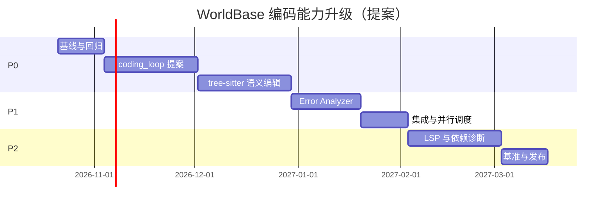

# WorldBase 编码能力缺口分析

**版本**：2.1
**评估日期**：2026-10-21
**评估范围**：WorldBase Rust Harness vs Codex / Claude Code / Cline
**目标**：在单一 Rust 后端上补齐编码专用能力，而不是重写已有运行时

> **文档导航**：[索引](./coding-capability-enhancement-index.md) · [快速开始](./coding-capability-enhancement-quick-start.md) · [Rust 实施](./coding-capability-enhancement-rust-implementation.md) · [架构](./coding-capability-enhancement-architecture.md) · [算法](./coding-capability-enhancement-algorithms.md) · [检查清单](./coding-capability-enhancement-checklist.md) · [缺口分析](./coding-capability-enhancement-gap-analysis.md) · [详细对标](./coding-capability-enhancement-benchmark-detailed.md) · [执行摘要](./coding-capability-enhancement-executive-summary.md)

---

## 执行摘要

### 评估口径

本文评分是产品与工程视角的内部估算，不是公开标准化 benchmark。依据包括：
- 当前 `harness-rs/` 实现能力。
- 常见编码任务中的工具闭环完整度。
- 对失败诊断、增量修改和多文件任务的支持程度。
- 可观测性、可回滚性和跨端一致性。

### 当前评分（估算）

| 工具 | 评分 | 主要优势 | 主要不足 |
|------|------|----------|----------|
| Codex | 95/100 | 编码循环、工具使用、验证与成本控制成熟 | 依赖外部模型能力 |
| Claude Code | 93/100 | 编辑器/语言服务联动和增量修改体验好 | 生态与部署条件限制 |
| Cline | 84/100 | 开源、可扩展、工具集成灵活 | 能力一致性依赖配置 |
| **WorldBase** | **58/100** | Rust 单一后端、工具完整、已有循环/压缩/并行基础 | 缺编码专用编排、语义编辑、结构化诊断和 LSP |

> 58 分不是“缺少循环”的分数，而是“有通用循环基础、缺编码专用闭环”的分数。

### 核心结论

1. **已经有通用 Agent 循环**：单执行段最多 128 步，可执行多轮工具调用。
2. **已经有上下文压缩**：能保留目标锚点、最近消息、关键路径和工具结果摘要。
3. **已经有并行基础**：连续只读工具可并行，独立子智能体可并行。
4. **仍有决定性缺口**：
   - 🧩 没有 `coding_loop` 编码任务专用状态机和验证门禁。
   - 🧩 没有 tree-sitter 语义定位和结构化增量编辑。
   - 🧩 没有 Error Analyzer 统一诊断与修复建议。
   - 🧩 没有 LSP 实时诊断与符号能力。
5. **现有基础设施不应重做**：正确路线是复用现有 Rust Harness，并把新能力作为可关闭的提案模块接入。

---

## 一、能力对标矩阵

评分说明：5 星为成熟能力，1 星为缺失或仅有原始工具。

| 维度 | WorldBase | Codex | Claude Code | Cline | 说明 |
|------|-----------|-------|-------------|-------|------|
| 通用工具循环 | ⭐⭐⭐⭐ | ⭐⭐⭐⭐⭐ | ⭐⭐⭐⭐⭐ | ⭐⭐⭐⭐ | 当前已有单段 128 步循环 |
| 编码任务编排 | ⭐⭐ | ⭐⭐⭐⭐⭐ | ⭐⭐⭐⭐⭐ | ⭐⭐⭐⭐ | 缺专用验证门禁和修复状态机 |
| 上下文压缩 | ⭐⭐⭐⭐ | ⭐⭐⭐⭐⭐ | ⭐⭐⭐⭐⭐ | ⭐⭐⭐⭐ | 当前已有通用压缩 |
| 增量修改 | ⭐⭐⭐ | ⭐⭐⭐⭐⭐ | ⭐⭐⭐⭐⭐ | ⭐⭐⭐⭐ | 文本 patch 可用，缺语法树定位 |
| 错误诊断 | ⭐⭐ | ⭐⭐⭐⭐⭐ | ⭐⭐⭐⭐⭐ | ⭐⭐⭐⭐ | 目前主要依赖原始命令输出 |
| 只读并行 | ⭐⭐⭐⭐ | ⭐⭐⭐⭐⭐ | ⭐⭐⭐⭐ | ⭐⭐⭐ | 连续只读工具可并行 |
| 子任务并行 | ⭐⭐⭐⭐ | ⭐⭐⭐⭐⭐ | ⭐⭐⭐⭐ | ⭐⭐⭐ | `spawn_subagents` 已可用 |
| 安全并行写入 | ⭐ | ⭐⭐⭐⭐ | ⭐⭐⭐⭐ | ⭐⭐⭐ | 依赖感知写入调度仍是提案 |
| LSP/实时诊断 | ⭐ | ⭐⭐⭐⭐ | ⭐⭐⭐⭐⭐ | ⭐⭐⭐ | LSP 为提案 |
| 依赖问题诊断 | ⭐⭐ | ⭐⭐⭐⭐ | ⭐⭐⭐ | ⭐⭐⭐ | 有命令能力，缺结构化分析 |
| 可观测性 | ⭐⭐⭐ | ⭐⭐⭐⭐⭐ | ⭐⭐⭐⭐ | ⭐⭐⭐ | 需补编码任务指标 |
| 权限隔离 | ⭐⭐⭐⭐ | ⭐⭐⭐⭐⭐ | ⭐⭐⭐⭐ | ⭐⭐ | 现有权限模型可复用 |

**总体判断**：WorldBase 的短板已从“没有工具”转为“工具之间缺编码语义和验证闭环”。

---

## 二、当前基线：哪些能力已经存在

### ✅ 1. 单段 128 步通用循环

- 位置：`harness-rs/crates/core/src/agent.rs`
- 行为：每个执行段最多 128 步，防止失控。
- 意义：具备多轮工具调用、观察结果和继续执行的基础。
- 不足：通用循环不知道“编码任务何时必须验证”，也不保证修复后重新验证所有门禁。

### ✅ 2. 上下文压缩

- 会在窗口压力、周期检查或执行段切换时触发。
- 保留用户目标锚点、最近消息、关键路径、命令、错误和工具结果摘要。
- 意义：长任务不会因上下文窗口耗尽而直接中断。
- 不足：通用摘要没有优先建模“当前目标符号、失败诊断、已改文件、验证状态”。

### ✅ 3. 只读工具并行

- 同一 assistant turn 中连续的只读工具调用可以并行。
- 典型工具：文件读取、列目录、搜索、项目状态、文档读取等。
- 写操作、命令、未知工具和宿主交互保持串行。
- 不足：编码任务的写入依赖图、冲突检测和安全并行写入尚未实现。

### ✅ 4. 并行子智能体

- `spawn_subagents` 可并行执行独立任务。
- 每个子任务需要完整上下文、路径、约束和允许/禁止工具。
- 主智能体负责检查结果并完成最终综合。
- 不足：缺少编码任务专用的拆分模板、结果去重和质量评估。

### ✅ 5. 文本增量修改

- `patch_project_file` 可以定向修改文件，避免每次全文重写。
- 不足：定位依赖字符串匹配和模型对文件内容的理解，缺少语法树校验。

### ✅ 6. Rust-only 跨端

- Desktop、CLI 与移动端共用 `harness-rs/`。
- 移动端使用手写 `dart:ffi` 绑定 C ABI。
- 不得新增第二语言后端或并行运行时。

---

## 三、核心缺口

### 缺口 1：🧩 缺编码任务专用编排（P0）

#### 当前现象

通用循环可以执行：

```text
读取 → 修改 → 运行命令 → 继续
```

但它不会强制形成：

```text
计划 → 侦察 → 最小修改 → 验证 → 结构化诊断 → 修复 → 再验证
```

#### 问题

- 模型可以跳过验证直接结束。
- 同一个错误可能被重复尝试，缺少轮次和证据记录。
- 失败后只把原始日志塞回上下文，难以定位根因。
- 没有统一的项目验证配置。
- 长任务达到 128 步后的续跑语义与编码任务状态没有关联。

#### 提案：`coding_loop`

- 增加 `CodingPhase` 状态机。
- 定义项目验证 profile。
- 修改后强制验证。
- 失败进入结构化诊断。
- 设置修复轮次、时间、token 和重复失败上限。
- 关闭特性开关时回到现有通用循环。

#### 优先级与工作量

- 优先级：🔴 P0
- 估算：4-6 周
- 依赖：基线观测、验证配置、Error Analyzer 接口

---

### 缺口 2：🧩 缺语义增量编辑（P0）

#### 当前现象

- 文本 patch 已可用。
- 编辑正确性依赖匹配旧文本和模型对文件结构的理解。
- 复杂文件中的多候选匹配需要额外读取和人工判断。

#### 问题

- 无法稳定表达“修改某个类型的方法”。
- 容易误改同名变量或相似代码块。
- 格式保留和最小 diff 没有语法层保证。
- 多文件重构时难以判断跨文件引用影响。

#### 提案：tree-sitter 语义编辑

- 解析文件并建立符号索引。
- 按符号路径、父节点和名称定位。
- 生成 `EditPlan`，再转成现有文本 patch。
- 冲突、歧义或语法边界不安全时拒绝写入。
- 无法解析时安全退化到现有文本工具并明确提示。

#### 优先级与工作量

- 优先级：🔴 P0
- 估算：4-6 周
- 依赖：tree-sitter 提案评审、目标语言清单、编辑测试集

---

### 缺口 3：🧩 缺结构化错误诊断（P1）

#### 当前现象

- `run_project_command` 能返回构建、测试和 lint 输出。
- 原始日志可以直接进入上下文，但缺少统一结构。

#### 问题

- 不同命令的错误格式不一致。
- 级联错误、重复错误和截断日志难以处理。
- 修复建议没有证据和置信度。
- 无法统计“哪类错误最常见、哪类修复真正有效”。

#### 提案：Error Analyzer

- 规范化 `Diagnostic { file, line, column, code, message, severity }`。
- 合并重复诊断，保留原始日志引用。
- 规则库覆盖常见构建、测试、类型和依赖错误。
- 修复建议附证据、影响范围、置信度和验证命令。
- 低置信度建议只展示，不自动应用。

#### 优先级与工作量

- 优先级：🟡 P1
- 估算：3-4 周
- 依赖：`coding_loop` 的 Verify 状态、验证配置

---

### 缺口 4：🧩 缺 LSP 实时诊断（P2）

#### 当前现象

- 编码反馈主要来自命令执行后的输出。
- 无语言服务器提供的实时诊断、符号和快速修复。

#### 问题

- 错误发现滞后。
- 符号查询和定义跳转依赖搜索。
- 编辑器与 Agent 对同一项目的诊断信息不一致。

#### 提案：LSP 适配层

- 接入诊断、符号、定义、引用和快速修复。
- 将诊断转换为 Error Analyzer 的统一结构。
- LSP 仅作为高置信度输入，不改变 Rust Harness 的单后端约束。

#### 优先级与工作量

- 优先级：🟢 P2
- 估算：4-6 周
- 依赖：Error Analyzer、桌面/编辑器集成评审

---

### 缺口 5：🧩 缺安全并行写入调度（P1）

#### 当前现象

- 只读并行和子智能体并行已实现。
- 写操作默认串行。

#### 问题

- 多文件独立修改仍有串行开销。
- 没有文件级依赖图和冲突检测。
- 子智能体如果同时写同一文件，可能互相覆盖。

#### 提案：依赖感知调度

- 构建文件/模块依赖图。
- 只有无依赖、无写冲突的任务允许并行。
- 未知依赖默认串行。
- 失败时停止依赖任务，保留已完成结果和证据。
- 对并发上限、取消和超时做压力测试。

#### 优先级与工作量

- 优先级：🟡 P1
- 估算：2-4 周
- 依赖：语义索引、编辑事务、子智能体结果汇总

---

### 缺口 6：🧩 缺编码感知上下文压缩（P1）

#### 当前现象

- 通用上下文压缩已实现。
- 能保留目标、最近消息、关键路径、命令和工具结果摘要。

#### 问题

- 摘要不专门区分“已改文件、未改文件、当前失败、已验证结论”。
- 代码片段、AST 节点和 diff 可能被均匀截断。
- 缺少压缩后的任务成功率指标。

#### 提案：压缩增强

- 优先保留当前错误、目标符号、相关文件片段和验证状态。
- 对 AST 节点、diff 和测试失败做结构化摘要。
- 用基准比较压缩前后的成功率、token 和重复读取次数。
- 保持现有压缩恢复行为与预算控制。

#### 优先级与工作量

- 优先级：🟡 P1
- 估算：2-3 周
- 依赖：语义索引、任务状态模型

---

### 缺口 7：🧩 缺依赖问题诊断（P2）

#### 当前现象

- 可以执行项目命令并观察依赖错误。
- 没有 manifest/lockfile 结构化分析与版本冲突解释。

#### 提案

- 解析项目 manifest 和 lockfile。
- 识别缺失依赖、版本冲突和不兼容约束。
- 生成修复计划，但默认需要验证命令确认。
- 依赖网络时提供离线失败说明，不假设一定能自动修复。

#### 优先级与工作量

- 优先级：🟢 P2
- 估算：3-4 周
- 依赖：Error Analyzer

---

## 四、优先级与路线图



| 优先级 | 能力 | 估算 | 直接价值 |
|--------|------|------|----------|
| P0 | `coding_loop` | 4-6 周 | 建立验证与修复闭环 |
| P0 | tree-sitter 语义编辑 | 4-6 周 | 提升定位和修改精度 |
| P1 | Error Analyzer | 3-4 周 | 降低人工读日志成本 |
| P1 | 安全并行写入 | 2-4 周 | 提升多文件任务效率 |
| P1 | 编码感知压缩 | 2-3 周 | 提升长任务稳定性 |
| P2 | LSP | 4-6 周 | 提升实时反馈 |
| P2 | 依赖诊断 | 3-4 周 | 减少依赖问题排查 |

> 日期和工期是提案估算，Week 2 基线完成后必须重新校准。

---

## 五、推荐实施方案

### 第一阶段：先测量，再改动（Week 1-2）

- 固定基准任务和评分。
- 记录 128 步循环、压缩、只读并行、子智能体的行为。
- 建立失败分类：定位错误、编辑错误、验证遗漏、诊断不足、循环耗尽。
- 定义特性开关和回滚标准。

### 第二阶段：建立编码闭环（Week 3-6）

- 实现 `coding_loop` 状态机。
- 接入项目验证配置。
- 强制修改后验证。
- 失败时进入统一诊断接口。

### 第三阶段：提高修改精度（Week 7-10）

- 实现 tree-sitter 索引和语义定位。
- 生成最小 `EditPlan`。
- 保留文本 patch 作为底层写入机制。
- 对歧义和不安全编辑拒绝写入。

### 第四阶段：提高诊断能力（Week 11-13）

- 解析构建、测试和 lint 输出。
- 建立 TOP 错误规则和修复模板。
- 自动修复仅限高置信度、可验证问题。

### 第五阶段：集成与发布（Week 14-16）

- 验证 Desktop、CLI 和移动端 `dart:ffi`。
- 做性能、上下文和并行压力测试。
- 输出基准报告、灰度方案和回滚文档。

---

## 六、明确不做什么

- ❌ 不新增第二语言后端。
- ❌ 不建立双运行时或语义等价的并行实现。
- ❌ 不把移动端改成自动生成桥接层；继续使用手写 `dart:ffi`。
- ❌ 不在没有基准证据的情况下宣称已达到行业一流。
- ❌ 不让语义编辑绕过现有权限、文件工具和审计。
- ❌ 不让低置信度错误建议直接写入代码。

---

## 七、验收指标

### P0

- 修改后执行验证的任务占比 ≥95%。
- 内部任务通过率相对基线提升 ≥20 个百分点。
- 无关文件改动率相对基线下降 ≥50%。
- 现有 128 步循环、压缩、只读并行和子智能体回归全部通过。

### P1

- 可结构化解析的失败日志占比 ≥90%。
- 高置信度修复建议的验证通过率 ≥70%。
- 并行任务结果正确汇总，无写冲突。
- 压缩后任务成功率不低于基线的 95%。

### P2

- LSP 诊断可转换为统一诊断结构。
- 依赖问题能生成可执行、可验证的修复计划。
- Desktop、CLI、Mobile 冒烟测试通过。

---

## 八、结论

WorldBase 已经完成了编码能力的基础设施建设：Rust Harness、128 步通用循环、上下文压缩、只读工具并行和子智能体并行。下一阶段的重点不是“补循环”或“补并行”，而是把现有基础组织成编码专用闭环：

**`coding_loop`（编排） + tree-sitter（定位） + Error Analyzer（诊断） + 验证门禁（质量） + LSP（反馈）**

所有新增能力都必须作为 Rust 模块实现，并在现有 Harness 内运行。移动端保持手写 `dart:ffi`。这样既能提升能力，也能保护现有架构的稳定性和可维护性。
