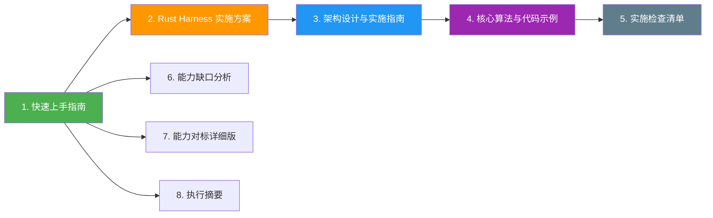

# WorldBase 编码能力升级 - 文档索引

**版本**：2.1
**最后更新**：2026-10-21
**目标**：在 Rust Harness 单一后端上，将 WorldBase 的编码能力提升至行业一流水平

> **基线约定**：本文档集只描述 `harness-rs/` 的 Rust 实现，不引入第二语言后端，也不设计并行运行时。移动端通过手写 `dart:ffi` 调用 Rust 导出的 C ABI。
>
> **状态标记**：✅ 已实现；🧩 提案（尚未实现）。tree-sitter 语义索引、语义编辑、Error Analyzer 与 `RepairPlan` 已落地 MVP；完整 `coding_loop` 编排与 LSP 仍为 🧩 提案。

---

## 📚 文档导航



### 推荐阅读顺序

1. [快速上手指南](./coding-capability-enhancement-quick-start.md)：15 分钟了解现状、提案边界和 Day 1 行动。
2. [Rust Harness 实施方案](./coding-capability-enhancement-rust-implementation.md)：`harness-rs/` 的实现约束和跨端方式。
3. [架构设计与实施指南](./coding-capability-enhancement-architecture.md)：目标模块、接口与数据流。
4. [核心算法与代码示例](./coding-capability-enhancement-algorithms.md)：算法草案与实现参考。
5. [实施检查清单](./coding-capability-enhancement-checklist.md)：逐项任务与验收标准。
6. [能力缺口分析](./coding-capability-enhancement-gap-analysis.md)：现有能力、真实缺口和优先级。
7. [能力对标详细版](./coding-capability-enhancement-benchmark-detailed.md)：评估方法、指标和路线图。
8. [执行摘要](./coding-capability-enhancement-executive-summary.md)：给决策者的一页纸结论。

---

## 🧭 现状与提案边界

| 能力 | 当前状态 | 说明 |
|------|----------|------|
| Rust Harness 单一后端 | ✅ 已实现 | Desktop、CLI 与移动端共用 `harness-rs/`；不维护第二语言实现 |
| 通用 Agent 循环 | ✅ 已实现 | 每个执行段最多 128 步，超过后进入下一执行段 |
| 上下文压缩 | ✅ 已实现 | 接近窗口上限或主动压缩周期触发；保留目标锚点、最近消息和工具结果摘要 |
| 只读工具并行 | ✅ 已实现 | 同一 assistant turn 中连续的只读工具调用可并行执行 |
| 并行子智能体 | ✅ 已实现 | `spawn_subagents` 可并行运行独立子任务，并汇总结果 |
| 文本增量修改 | ✅ 已实现 | `patch_project_file` 支持定向修改，但仍以文本匹配为主 |
| 移动端 FFI | ✅ 已实现 | 手写 `dart:ffi` 绑定，调用 `worldbase_start` 等 C ABI |
| `coding_loop` 专用编排 | 🧩 提案 | 在现有通用循环之上增加编码任务状态、验证门禁和修复策略 |
| 多语言 tree-sitter 语义编辑 | ✅ 已实现（MVP） | TS/JS/TSX、Python、Go、Rust、Java：符号索引、语义定位、replace/insert/delete/rename |
| Error Analyzer | ✅ 已实现（MVP） | 28 个错误模式、结构化诊断、稳定失败签名与 `RepairPlan` |
| LSP 集成 | ✅ 已实现（MVP） | publishDiagnostics、符号、定义、hover 数据解析；live server 生命周期待接入 |
| 依赖问题诊断 | ✅ 已实现（MVP） | 解析 manifest/lockfile 与包管理输出，生成安装/更新/重建 lockfile 建议 |

**关键结论**：当前已经有循环、压缩和并行基础，不需要从零实现；真正需要补的是编码任务专用策略、语义编辑、结构化错误诊断和验证闭环。

---

## 📖 核心文档

### 1️⃣ 快速上手指南 ⭐ 必读
**文件**：[`coding-capability-enhancement-quick-start.md`](./coding-capability-enhancement-quick-start.md)

- 现状与目标对照
- Rust-only 实施约束
- 16 周提案路线
- Day 1 `cargo` 行动清单
- 手写 `dart:ffi` 接入说明

**适合**：项目负责人、Rust 工程师（首次阅读）

---

### 2️⃣ Rust Harness 实施方案 ⭐ 核心方案
**文件**：[`coding-capability-enhancement-rust-implementation.md`](./coding-capability-enhancement-rust-implementation.md)

- `harness-rs/` 工作区结构
- Rust 侧核心数据结构与协议
- Tokio 异步任务与只读工具并行
- Desktop、CLI、Mobile 的统一能力边界
- 移动端手写 FFI 约束

**适合**：Rust 工程师、架构师

**方案原则**：
- ✅ 单一 Rust 后端
- ✅ 共享协议与类型
- ✅ 移动端手写 `dart:ffi`
- ✅ 通过 `cargo fmt`、`cargo clippy`、`cargo test` 验证

---

### 3️⃣ 架构设计与实施指南
**文件**：[`coding-capability-enhancement-architecture.md`](./coding-capability-enhancement-architecture.md)

- 现有 Harness 与提案模块的分层关系
- 🧩 `coding_loop` 编排器
- ✅ Smart Editor（tree-sitter 语义编辑，MVP）
- ✅ Error Analyzer（MVP）
- 🧩 LSP 适配层
- 数据模型、接口与测试策略

**适合**：开发工程师、架构师（实施参考）

---

### 4️⃣ 核心算法与代码示例
**文件**：[`coding-capability-enhancement-algorithms.md`](./coding-capability-enhancement-algorithms.md)

- 🧩 编码任务状态机
- 🧩 语义定位与 patch 生成
- 🧩 错误规范化与分类
- ✅ 现有上下文压缩策略的扩展点
- ✅ 现有只读并行调度与子智能体的编码场景用法

**适合**：Rust 工程师（编码时参考）

---

### 5️⃣ 实施检查清单
**文件**：[`coding-capability-enhancement-checklist.md`](./coding-capability-enhancement-checklist.md)

- 6 个阶段逐项任务
- 现状回归保护
- 每个阶段的验收标准
- Rust 质量门禁与跨端 FFI 检查

**适合**：项目经理、开发工程师（日常追踪）

---

### 6️⃣ 能力缺口分析报告
**文件**：[`coding-capability-enhancement-gap-analysis.md`](./coding-capability-enhancement-gap-analysis.md)

- 当前真实基线
- 通用循环与编码专用循环的差异
- 语义编辑、错误诊断、LSP 等缺口
- 改进方案与优先级

**适合**：决策者、产品经理

---

### 7️⃣ 能力对标详细版
**文件**：[`coding-capability-enhancement-benchmark-detailed.md`](./coding-capability-enhancement-benchmark-detailed.md)

- 能力矩阵与评分方法
- 可复现的内部基准设计
- 提案验收指标
- 分阶段路线图

**适合**：架构师、技术调研

---

### 8️⃣ 执行摘要（决策版）
**文件**：[`coding-capability-enhancement-executive-summary.md`](./coding-capability-enhancement-executive-summary.md)

- 一页纸结论
- 投资优先级与资源方案
- 风险与回报
- 决策清单

**适合**：管理层、快速决策

---

## 🎯 使用场景

### 场景 1：项目启动（Day 1）

```bash
# 阅读与评审
# 1. 快速上手指南
# 2. Rust Harness 实施方案
# 3. 实施检查清单

# 在 Rust 工作区建立基线
cd harness-rs
cargo fmt --all -- --check
cargo check -p worldbase-core
cargo test -p worldbase-core
```

- 确认只修改 Rust Harness。
- 确认移动端继续使用手写 `dart:ffi`。
- 为现有 128 步循环、上下文压缩、只读并行和子智能体补充回归测试。
- 再评审 🧩 `coding_loop`、tree-sitter、Error Analyzer 与 LSP 的提案范围。

### 场景 2：开发过程

- 先补基准和观测，再改编排逻辑。
- `coding_loop` 只增强现有 Agent 循环，不替换权限、工具和协议层。
- 语义编辑能力以 tree-sitter 解析结果为输入，文本 patch 保留为底层写入机制。
- 每个阶段都运行 `cargo fmt`、`cargo clippy` 和相关测试。

### 场景 3：汇报与复盘

- 管理层阅读执行摘要。
- 技术团队对照缺口分析和详细对标。
- 项目经理使用检查清单跟踪进度。
- 所有“目标值”均标注为提案指标，不表述为当前已达成能力。

---

## 📈 项目概况

### 目标能力（提案）

| 维度 | 当前基线 | 16 周目标 | 说明 |
|------|----------|-----------|------|
| 编码任务验证闭环 | 通用循环可执行验证命令，但无统一门禁 | 每次修改后自动执行项目定义的质量门禁 | `coding_loop` 提案 |
| 增量修改精度 | 文本 patch 可用 | 语法树辅助定位，减少无关改动 | tree-sitter 提案 |
| 错误诊断 | 原始命令输出 | 规范化诊断 + 修复建议 | Error Analyzer 提案 |
| 并行效率 | 只读工具与子任务可并行 | 在安全边界内增加依赖感知调度 | 调度提案 |
| 上下文效率 | 通用压缩已实现 | 编码感知的摘要与片段选择 | 压缩增强提案 |
| 实时诊断 | 命令执行后反馈 | LSP 诊断接入 | LSP 提案 |

> 上表是目标，不是当前完成度。评分与收益均为估算，需用内部基准验证。

### 实施计划

- **P0（Week 1-6）**：基线观测 + 🧩 `coding_loop` 编码任务编排。
- **P0（Week 7-10）**：🧩 tree-sitter 语义索引与增量编辑。
- **P1（Week 11-13）**：✅ Error Analyzer（MVP 已落地，继续补真实日志回归）。
- **P1（Week 14-15）**：集成、回归与依赖感知调度。
- **P2（Week 16+）**：🧩 LSP、依赖诊断与体验优化。
- **推荐人力**：2 名 Rust 工程师 + 1 名测试/评估工程师（可兼职）。

### 技术栈

**当前**：
```text
Rust 2021 + Cargo
Tokio                 异步运行时与任务调度
rusqlite              SQLite 持久化
serde / serde_json    协议与数据序列化
anyhow / thiserror    错误处理
dart:ffi              移动端手写 C ABI 绑定
```

**提案新增**：
```text
tree-sitter           语法树解析与语义定位（🧩）
lsp-types / lsp-server  LSP 消息与适配（🧩）
```

依赖在对应提案获批后再加入 `harness-rs/Cargo.toml`，不提前作为现有能力宣传。

---

## 🔄 文档更新记录

| 日期 | 版本 | 变更 |
|------|------|------|
| 2026-10-21 | 2.1 | 校正当前能力基线；明确 Rust-only、手写 `dart:ffi` 和提案边界 |
| 2026-10-21 | 2.0 | 改为 Rust Harness 方案 |
| 2026-10-21 | 1.0 | 初始版本 |

---

## 📞 常见问题

**Q: 是否维护两套 Harness？**
A: 否。只维护 `harness-rs/` 一套 Rust 实现。

**Q: 移动端是否生成桥接代码？**
A: 否。移动端使用手写 `dart:ffi` 绑定 Rust 导出的 C ABI。

**Q: 当前是否已经有 128 步循环？**
A: 是。每个执行段最多 128 步；通用循环能力不等于 `coding_loop` 提案中的编码任务编排。

**Q: 当前是否已经支持上下文压缩？**
A: 是。通用压缩已存在；提案关注编码场景下的摘要质量和文件片段选择。

**Q: 当前是否已经支持并行？**
A: 只读工具调用和子智能体已经可以并行；写操作与依赖任务仍应保持串行，除非后续提案明确证明安全。

**Q: 为什么先补观测和回归测试？**
A: 已有循环、压缩和并行能力必须保持稳定，任何提案都不能破坏现有运行时语义。

---

## ✅ 启动前检查

- [ ] 已阅读快速上手指南。
- [ ] 已确认只修改 `harness-rs/` 的 Rust 后端。
- [ ] 已确认移动端使用手写 `dart:ffi`。
- [ ] 已记录现有 128 步循环、上下文压缩、只读并行和子智能体的回归用例。
- [ ] 已区分 ✅ 当前能力与 🧩 提案。
- [ ] 已建立内部编码任务基准集。

### 立即行动

```bash
# 1. 建立分支
git checkout -b feature/coding-capability-enhancement

# 2. 验证 Rust 工作区
cd harness-rs
cargo fmt --all -- --check
cargo check -p worldbase-core
cargo test -p worldbase-core
```

---

**维护者**：WorldBase AI 团队
**版本**：2.1
**最后更新**：2026-10-21
