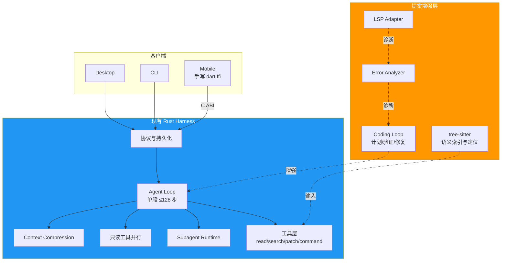
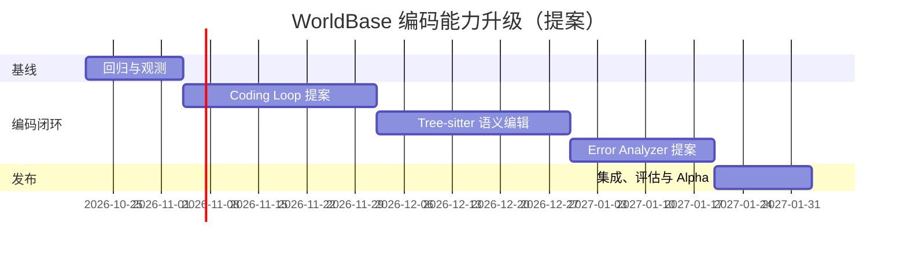

# WorldBase 编码能力升级 - 快速上手指南

**版本**：2.1
**目标读者**：项目负责人、Rust 工程师
**预计阅读时间**：15 分钟

> **文档导航**：[索引](./coding-capability-enhancement-index.md) · [快速开始](./coding-capability-enhancement-quick-start.md) · [Rust 实施](./coding-capability-enhancement-rust-implementation.md) · [架构](./coding-capability-enhancement-architecture.md) · [算法](./coding-capability-enhancement-algorithms.md) · [检查清单](./coding-capability-enhancement-checklist.md) · [缺口分析](./coding-capability-enhancement-gap-analysis.md) · [详细对标](./coding-capability-enhancement-benchmark-detailed.md) · [执行摘要](./coding-capability-enhancement-executive-summary.md)

---

## 🎯 一句话总结

WorldBase 已经有一套可运行、可压缩上下文、可并行只读工具和子智能体的 Rust Harness。本次升级不是重写 Harness，而是在现有循环之上补一个**编码任务专用闭环**：计划、语义修改、验证、错误诊断、修复、再验证。

状态说明：✅ 已实现；🧩 提案（尚未实现）。

---

## 🚀 5 分钟速览

### 当前基线 ✅

```text
用户请求
  → Rust Agent Loop（单执行段最多 128 步）
  → read_project_file / grep_search / list_project_files
  → patch_project_file 或 write_project_file
  → run_project_command
  → 上下文压缩（按窗口压力或周期触发）
  → 只读工具并行 / spawn_subagents 并行
  → finish_task
```

**已经具备**：
- ✅ 单段最多 128 步的通用工具循环。
- ✅ 上下文压缩，保留用户目标、最近消息、关键路径和工具结果摘要。
- ✅ 同一轮中连续只读工具的并行执行。
- ✅ 独立子任务通过 `spawn_subagents` 并行执行。
- ✅ 文本增量修改与命令执行。
- ✅ Desktop、CLI、Mobile 共用 Rust Harness；移动端通过手写 `dart:ffi` 接入。

**仍然缺少**：
- ❌ 编码任务专用的验证门禁和修复状态机（🧩 `coding_loop` 提案）。
- ❌ 基于语法树的语义定位与结构化编辑（🧩 tree-sitter 提案）。
- ❌ 编译、测试、lint 输出的统一规范化与修复建议（🧩 Error Analyzer 提案）。
- ❌ LSP 诊断、符号和快速修复接入（🧩 LSP 提案）。
- ❌ 面向依赖关系的安全并行写入调度（🧩 调度提案）。

### 目标闭环 🧩

```text
任务计划
  → 并行只读侦察（文件、搜索、子智能体）
  → 生成最小修改
  → tree-sitter 语义定位
  → 写入并保留格式
  → cargo fmt / check / test / clippy（按项目定义）
  → Error Analyzer 规范化诊断
  → 修复或停止并说明原因
  → 验收门禁
  → finish_task
```

**核心原则**：增强通用循环，不替换权限层、工具层、协议层和持久化层；不新增第二语言后端。

---

## 📊 核心改进

### 改进 1：🧩 `coding_loop` 编码任务编排（P0）

**现状**：通用 Agent 循环可以多轮调用工具，但“何时必须验证、失败后何时重试、哪些错误不可恢复”主要依赖模型判断。

**目标**：在现有循环外层或旁路增加确定性的编码任务状态：

```rust
// 提案接口示意，不是当前代码
pub enum CodingPhase {
    Plan,
    Inspect,
    Edit,
    Verify,
    Diagnose,
    Repair,
    Complete,
    Blocked,
}

pub struct CodingLoopPolicy {
    pub max_repair_rounds: u32,
    pub verification_profile: String,
}
```

**验收方向**：
- 修改后必须执行项目声明的质量门禁。
- 失败诊断进入结构化记录，而不是只把原始日志追加到上下文。
- 达到修复轮次、预算或时间上限时明确停止并报告。
- 现有 128 步循环和上下文压缩行为保持兼容。

### 改进 2：🧩 tree-sitter 语义增量编辑（P0）

**现状**：`patch_project_file` 已能做文本级增量修改，但定位依赖模型读取内容和匹配旧文本。

**目标**：
- 用 tree-sitter 建立函数、类型、方法、导入和引用索引。
- 用语义定位把“修改某个方法的错误处理”转换为明确的字节范围。
- 生成最小 patch，保留缩进、注释和未修改区域。
- 冲突时拒绝盲目写入，返回可诊断的定位错误。

### 改进 3：🧩 Error Analyzer（P1）

**现状**：`run_project_command` 能返回原始编译、测试和 lint 输出。

**目标**：
- 将不同命令输出规范化为 `Diagnostic { file, line, column, code, message, severity }`。
- 建立常见错误的匹配规则和修复模板。
- 为每个修复建议附带证据、影响范围和验证命令。
- 与 `coding_loop` 的 Verify → Diagnose → Repair 状态衔接。

### 改进 4：✅ 并行能力 → 🧩 编码场景增强

**现状**：
- 连续只读工具调用已经并行。
- `spawn_subagents` 已经支持独立子任务并行。

**提案**：
- 将读任务按文件、模块和问题域拆分给子智能体。
- 对写入任务建立显式依赖图，只有无冲突、无数据依赖的修改才允许并行。
- 默认保守：未知工具、写操作、命令执行和宿主交互保持串行。

### 改进 5：✅ 上下文压缩 → 🧩 编码感知压缩

**现状**：通用压缩已经能保留目标锚点、最近消息、关键路径、命令和工具结果摘要。

**提案**：
- 压缩时优先保留当前错误、目标符号、相关文件片段和已验证结论。
- 对 AST 节点、diff 和测试失败做结构化摘要。
- 用基准测量压缩后的任务成功率，而不是只比较 token 数。

### 改进 6：🧩 LSP 集成（P2）

**目标**：
- 接入诊断、符号查询、定义跳转和快速修复。
- 将 LSP 诊断作为 Error Analyzer 的一个高置信度来源。
- LSP 不可用时保持现有命令验证路径，不引入另一套 Harness。

---

## 🏗️ 系统架构（一图看懂）



**边界要求**：
- 现有 Rust Harness 是唯一后端。
- 提案模块必须作为 Rust crate/模块实现。
- 移动端只通过手写 `dart:ffi` 绑定 C ABI。
- 不复制一套语义等价的后端，也不建立双运行时。

---

## 📅 16 周提案路线

| 周数 | 里程碑 | 可验证成果 |
|------|--------|-----------|
| Week 1-2 | 基线冻结 | 128 步循环、压缩、只读并行、子智能体的回归测试与指标采集 |
| Week 3-6 | 🧩 `coding_loop` | 编码任务状态机、验证门禁、修复轮次和停止条件 |
| Week 7-10 | 🧩 语义编辑 | tree-sitter 索引、语义定位、最小 patch 和格式保留 |
| Week 11-13 | 🧩 Error Analyzer | 诊断规范化、TOP 错误模式、修复建议与验证 |
| Week 14-15 | 集成与调度 | 端到端闭环、依赖感知并行、性能与稳定性验证 |
| Week 16 | Alpha | 基准报告、灰度开关、回滚方案和用户反馈 |



> 排期是提案估算，需在 Week 2 基线完成后重新校准。

---

## 👥 团队配置

### 推荐配置（2-3 人）

| 角色 | 职责 | 关键能力 |
|------|------|----------|
| Rust 工程师 A | `coding_loop`、Error Analyzer、策略门禁 | Rust、Tokio、Agent 工具循环、可观测性 |
| Rust 工程师 B | tree-sitter 索引、语义定位、增量编辑 | Rust、语法树、文本编辑、测试设计 |
| 测试/评估工程师 C | 基准集、回归、指标、跨端验证 | Rust 测试、任务评估、移动端 FFI 验证 |

### 最小配置（1 人）

- 只能先做 P0 的 `coding_loop` 和最小基准。
- 语义编辑、Error Analyzer、LSP 依次排队，不承诺 16 周全部完成。

---

## 💰 成本与收益估算

> 以下为规划估算，不是已实现收益。必须先通过内部基准验证成功率、耗时和 token 消耗。

| 项目 | 估算 | 说明 |
|------|------|------|
| 人力 | ¥350k - ¥520k | 2-3 人 × 16 周 |
| 评测与 API | ¥30k - ¥60k | 基准任务、重复测试、长任务 |
| 工具 | ¥0 - ¥20k | tree-sitter 与 LSP 实现均为开源依赖 |
| **总计** | **¥380k - ¥600k** | 以最终排期为准 |

**预期收益方向**：
- 减少因错误定位造成的无关改动。
- 减少用户手工复制编译/测试错误。
- 缩短“修改 → 验证 → 修复”循环。
- 在不破坏现有运行时的前提下提升长任务完成率。

ROI 不在本指南中给出确定数字；应在基准报告完成后由执行摘要更新。

---

## 🎯 成功标准（提案）

### Alpha 验收

| 维度 | 指标 | 目标 |
|------|------|------|
| 正确性 | 内部编码任务通过率 | 相对基线提升 ≥20 个百分点 |
| 修改质量 | 无关文件改动率 | 相对基线下降 ≥50% |
| 诊断质量 | 可结构化解析的失败日志占比 | ≥90% |
| 闭环能力 | 修改后执行验证的任务占比 | ≥95% |
| 稳定性 | 现有核心测试 | 全部通过 |
| 回滚 | 提案模块可独立关闭 | 必须满足 |
| 性能 | 只读并行回归 | 不慢于基线 |
| 成本 | 单任务平均 token | 不超过基线的 110% |

### 发布门禁

- `cargo fmt --all -- --check` 通过。
- `cargo clippy --workspace --all-targets -- -D warnings` 通过。
- 相关 crate 的 `cargo test` 通过。
- 128 步循环、上下文压缩、只读并行和子智能体的回归用例通过。
- Desktop、CLI、Mobile FFI 冒烟测试通过。

---

## 🛠️ 快速启动（Day 1）

### 第一天行动清单

```bash
# 1. 创建分支
git checkout -b feature/coding-capability-enhancement

# 2. 检查 Rust 工作区
cd harness-rs
cargo metadata --no-deps

# 3. 建立当前基线
cargo fmt --all -- --check
cargo check -p worldbase-core
cargo test -p worldbase-core

# 4. 记录现有行为
# - 单段最多 128 步
# - 上下文压缩触发与目标保留
# - 连续只读工具并行
# - spawn_subagents 并行
```

### 第一周目标

- [ ] 明确当前能力与提案能力的边界。
- [ ] 为 128 步循环补充/确认回归测试。
- [ ] 为上下文压缩补充/确认回归测试。
- [ ] 为只读工具并行和子智能体补充/确认回归测试。
- [ ] 建立 50-100 个内部编码任务的基线集。
- [ ] 定义验证门禁的项目配置格式。
- [ ] 确认移动端继续使用手写 `dart:ffi`。

---

## 📱 移动端 FFI 约束

移动端不生成桥接代码，也不引入第二套业务后端。Dart 侧直接声明 C ABI 函数：

```dart
import 'dart:ffi';

typedef WorldbaseStartNative = Int32 Function(Pointer<Uint8> dataDir, Uint32 portHint);
typedef WorldbaseStartDart = int Function(Pointer<Uint8> dataDir, int portHint);

final library = DynamicLibrary.open('libworldbase_mobile_ffi.dylib');
final start = library.lookupFunction<WorldbaseStartNative, WorldbaseStartDart>(
  'worldbase_start',
);
```

Rust 侧保持稳定的 `extern "C"` 入口，新增字段时优先扩展版本化结构或新增函数，不改变已有 ABI 含义。

**FFI 检查项**：
- 指针所有权明确，释放责任在调用方或 Rust 侧二选一。
- 字符串编码、缓冲区长度和返回码在两端一致。
- Panic 在 FFI 边界被捕获并转换为错误码。
- iOS 静态链接、macOS/Android 动态库各有冒烟测试。
- Dart 绑定由项目代码维护，不依赖自动生成桥接层。

---

## 📚 学习资源

| 主题 | 资源 | 时间 |
|------|------|------|
| Rust 异步与 Tokio | Tokio 官方教程 | 2h |
| tree-sitter（提案） | tree-sitter 官方文档 | 2h |
| LSP（提案） | Language Server Protocol 规范 | 2h |
| 手写 Dart FFI | Dart `dart:ffi` 文档 | 2h |
| Agent 工具循环 | 本仓库 `harness-rs/crates/core/src/agent.rs` | 2h |

---

## ⚠️ 风险预警

| 风险 | 概率 | 影响 | 应对 |
|------|------|------|------|
| 语义编辑边界判断错误 | 中 | 高 | 先只读索引，再逐语言开放写入；冲突时拒绝修改 |
| tree-sitter 多语言维护成本 | 中 | 中 | 优先覆盖真实项目语言，按基准收益排序 |
| Error Analyzer 误分类 | 中 | 高 | 规则带证据和置信度，低置信度只建议不自动修改 |
| 编码循环过度重试 | 中 | 高 | 明确轮次、时间和 token 上限 |
| 并行写入冲突 | 低 | 高 | 默认串行；只有无依赖任务允许并行 |
| FFI ABI 漂移 | 中 | 高 | 版本化接口、两端冒烟测试、Panic 捕获 |
| 基准不可复现 | 中 | 高 | 固定任务、环境、模型参数和评分脚本 |

---

## 🔁 协作流程


### 分支策略

```text
main
  └── develop
      ├── feature/coding-loop
      ├── feature/tree-sitter-editor
      └── feature/error-analyzer
```

- 提案模块独立 crate/模块，减少对现有核心的侵入。
- 每个 PR 必须包含行为测试和基准对比。
- 默认通过特性开关启用，保留关闭路径。

---

## ❓ 常见问题

**Q: 是否要从零编写编码循环？**
A: 不需要。现有通用循环已经支持单段最多 128 步、上下文压缩、只读工具并行和子智能体。`coding_loop` 是编码任务策略层提案。

**Q: 当前是否已经支持上下文压缩？**
A: 是。提案只增强编码场景下的摘要和片段选择。

**Q: 当前是否已经支持并行？**
A: 只读工具和独立子智能体可以并行。写操作默认串行，依赖感知并行写入仍是提案。

**Q: 是否允许增加另一套后端？**
A: 不允许。所有能力在 `harness-rs/` 中实现并复用现有协议。

**Q: 移动端为何手写 `dart:ffi`？**
A: 保持 ABI 清晰、依赖少、可审计，并避免再引入一层生成工具链。

---

## ✅ 准备好了吗？

### 启动前检查

- [ ] 已阅读本指南和文档索引。
- [ ] 已确认 Rust 工具链可用。
- [ ] 已确认只修改 `harness-rs/`。
- [ ] 已了解现有 128 步循环、上下文压缩、只读并行和子智能体能力。
- [ ] 已列出 `coding_loop`、tree-sitter、Error Analyzer、LSP 的提案边界。
- [ ] 已安排内部基准集负责人。
- [ ] 已安排移动端手写 `dart:ffi` 验证负责人。

### 下一步

1. 召开 1 小时启动会，逐项确认现状与提案。
2. 运行 Day 1 的 `cargo` 基线命令。
3. 建立 50-100 个编码任务的基线报告。
4. 按检查清单开始 Week 1-2 工作。

---

**版本**：2.1
**最后更新**：2026-10-21
**维护者**：WorldBase AI 团队
