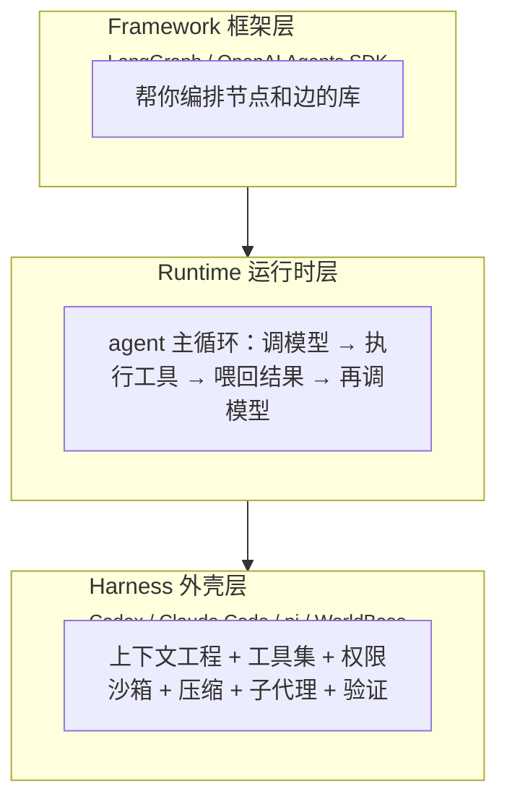
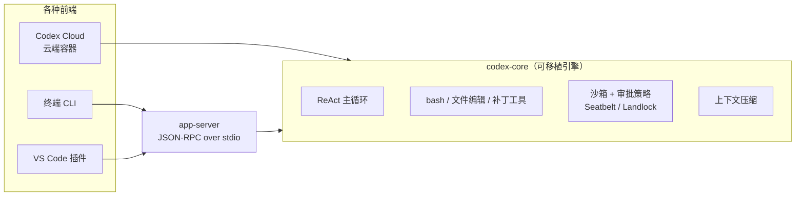
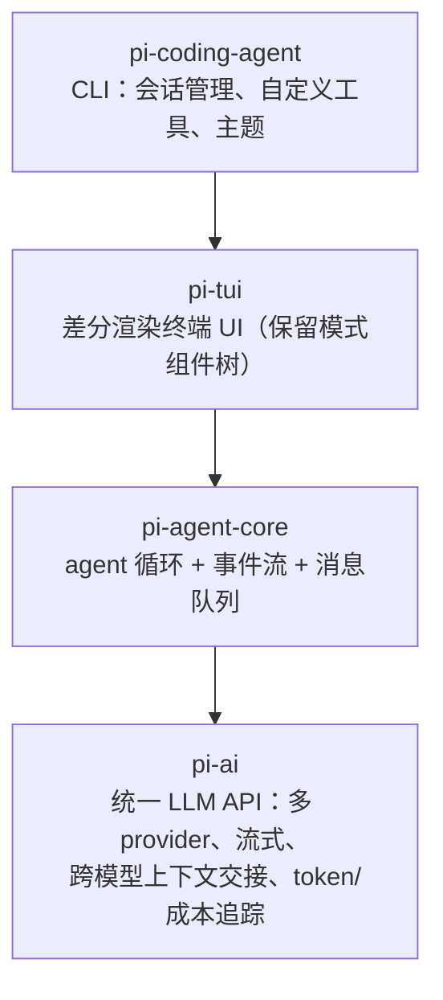
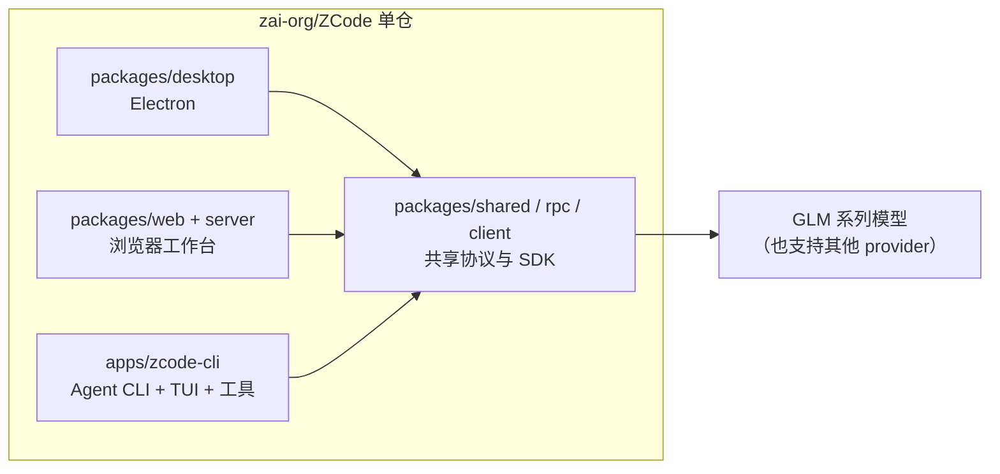
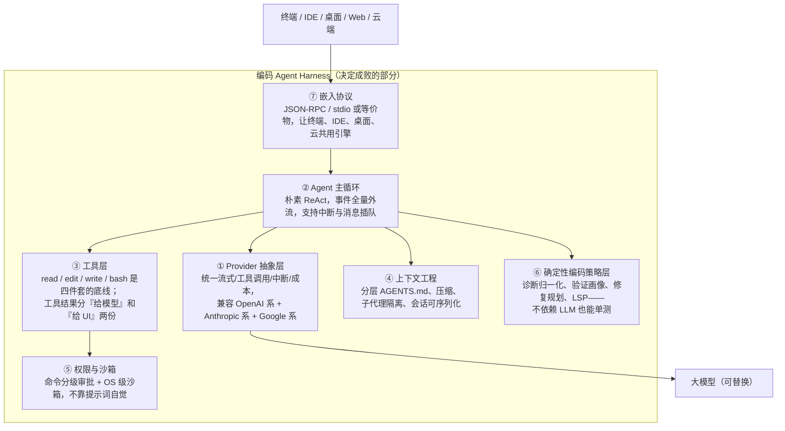
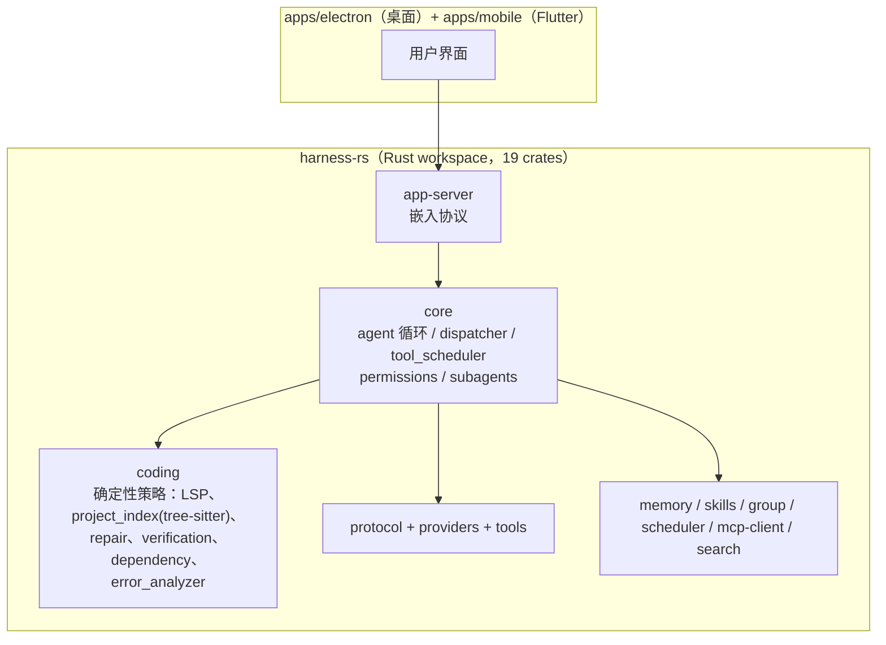
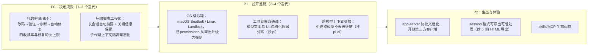

# 如何做一个好的编码 Agent：架构、对比与升级指南

> 一篇写给普通开发者和技术决策者的科普文。读完你会明白：Codex、Claude Code、OpenCode、pi、ZCode、dsh（DeepSeek Harness）这些工具到底在做什么、它们的架构为什么殊途同归、各自的取舍是什么，以及——如果你正在做一个自己的编码 Agent（比如本文后半部分剖析的 WorldBase），该怎么一步步把它做好。

---

## 一、先纠正一个直觉：编码 Agent 的核心不是模型，是"外壳"

很多人以为编码 Agent 的竞争力在于背后接的是哪个大模型。其实 2025–2026 年业界最大的共识恰恰相反：**模型是发动机，harness（外壳/马具）才是整车**。

同一个模型，套不同的 harness，编程表现可以天差地别。所谓 harness，就是包裹在模型外面的那一整套工程：给模型什么提示词、给它哪些工具、工具结果怎么喂回去、上下文满了怎么办、它想删文件时谁来拦、它写完代码谁来验证。

LangChain 官方把这套东西拆成三层概念：



关键判断：**做编码 Agent 产品，主流做法是绕过框架，自己写一个朴素的 agent 循环（业界流传"100 行循环胜过引入框架"），把全部精力放在 harness 层**。这不是说框架不好，而是编码场景对"精确控制进入模型的每一个 token"的要求太极端，框架的抽象反而碍事。pi 的作者 Mario Zechner（libGDX 创始人）把这称为"上下文工程至上"——他造 pi 的动机就是主流 harness 总在你背后偷偷往上下文里塞东西，UI 上还不显示。

一个编码 Agent 的主循环，剥到最光就长这样：

```
loop:
  把[系统提示 + 历史消息 + 工具结果] 发给模型
  如果模型返回普通文本 → 结束，把答案给用户
  如果模型返回工具调用 → 校验权限 → 执行 → 结果追加进历史 → 继续 loop
```

所有产品的差异，都在这个循环的"周边工程"里。下面我们就来看这些周边工程在各家手里长什么样。

---

## 二、六款代表性产品的架构拆解

### 2.1 Codex（OpenAI）：生产级分层引擎，协议化嵌入的范本

Codex 是开源的（github.com/openai/codex，Apache-2.0，Rust 编写），它最值得学的是**进程与协议设计**：



- **核心思想**：把 agent 循环写成一个与 UI 无关的 core，外面用 `app-server`（JSON-RPC over stdio）暴露协议。终端、IDE 插件、云端都只是"客户端"。这就是为什么 OpenAI 能用一份引擎同时支撑本地 CLI 和 Codex Cloud——**agent 循环贴近工具执行环境**：交互式开发跑在你本地进程，异步委派任务跑在云端容器，同一份代码双形态部署。
- **安全是设计出来的，不是提示出来的**：macOS 用 Seatbelt、Linux 用 Landlock 做系统级沙箱，模型想越权写文件会被操作系统拦住，而不是靠提示词里写"请不要乱删"。
- **优点**：成熟度最高、沙箱/审批能力最强、协议化嵌入最方便（你要做自己的产品，直接嵌入 codex-core 是现成路径）。
- **缺点**：为 OpenAI 模型深度优化，接别家模型体验打折；功能全家桶化后，上下文里自动注入的东西越来越多，可定制性下降。

### 2.2 Claude Code：功能最全的"宇宙飞船"

Claude Code 是闭源的，但源码分析文章和它的 Agent SDK 暴露了同样的架构：朴素主循环 + bash 作为万能工具 + 子代理隔离上下文 + 自动压缩。它的差异化在于**生态成熟度**：Skills、Subagents、Hooks、MCP 支持、计划模式（plan mode）、后台任务……应有尽有。

- **优点**：开箱体验最好，长任务稳定性业界标杆，子代理/技能体系最完善。
- **缺点**：pi 作者的吐槽很有代表性——"变成了 80% 功能我都用不到的宇宙飞船"，系统提示词和工具每个版本都变，会悄悄改变模型行为、打破你已有的工作流；闭源，无法审计上下文。

### 2.3 OpenCode：开源社区的平替，模型无关 + TUI 好看

OpenCode（TypeScript/Bun）是"开源版 Claude Code"的定位：客户端/服务端架构（TUI 只是一个客户端，agent 逻辑在 server 进程）、provider 插件化（它维护的 models.dev 模型数据库连 pi 都在用）、全屏 TUI 界面华丽、LSP 集成和 MCP 支持齐全。

- **优点**：完全开源、模型无关做得最彻底（接自托管模型最积极）、TUI 体验好、社区活跃。
- **缺点**：基于 Vercel AI SDK 抽象层，接自托管模型时 tool calling 经常出兼容问题（pi 作者点名批评）；版本迭代快带来不稳定；event 表流式全量落库导致 SQLite 膨胀是实际运维中踩过的坑（数 GB 级）。

### 2.4 pi：极简主义的反面教材（褒义）

pi（@mariozechner/pi-coding-agent，MIT）是 Mario Zechner"受够了所有 AI Agent"之后的自造轮子，哲学是"我不需要的功能就不存在"。它的架构干净得像教科书：



它的"反功能"清单就是最好的设计宣言：**无 MCP、无子代理、无计划模式、无内置待办、无后台 bash、默认 YOLO（不弹权限框）**。系统提示词不到 1000 tokens，工具只有 4 个（read / bash / edit / write）。

真正值得抄的作业有两个：
1. **跨 provider 上下文交接**：会话中途从 Claude 切到 GPT 再切到 Gemini，thinking 痕迹转成 `<thinking>` 标签文本继续传递——多模型时代的硬需求，别家基本没做。
2. **工具结果双通道**：每个工具返回"给模型看的文本"和"给 UI 看的结构化数据"两份，UI 再也不用去解析工具输出的文本。

- **优点**：上下文完全透明可控、代码量小可全文读懂、多模型支持最好、session 格式干净可后处理。
- **缺点**：没有子代理和压缩策略的精细工程，长程大任务能力弱于 Claude Code；YOLO 默认不适合新手和团队场景；生态是个人项目量级。

### 2.5 ZCode（智谱）：国产全形态工作台，三端同仓

ZCode（github.com/zai-org/ZCode）是 Z.ai 围绕 GLM 模型做的官方 harness，2026 年开源。它的独特性不在 agent 循环，而在**产品形态**：Electron 桌面 + Web 浏览器 + 终端 TUI 三端共用一套源码和运行时。



- **优点**：一个仓库里能读到"桌面端怎么嵌 agent、Web 端怎么远程连 agent、终端怎么直接跑 agent"的完整答案，是学习多形态集成的最佳样本；对国内用户网络和账号体系友好；支持 SSH/WSL 远程工作区。
- **缺点**：为 GLM 深度优化，换模型不是它的主战场；三端同仓意味着仓库庞大，只想研究循环本身的话噪音多。

### 2.6 dsh / DeepSeek Harness：一切皆插件的内核实验

dsh（github.com/deepseek-ai/deepseek-harness，MIT）是 DeepSeek 开源的 harness，走第三条路线：**基于 Cordis 内核的插件化运行时**，模型无关、一切能力（工具、权限、UI 绑定）都是可组合插件。

- **优点**：可组合性最强，适合深度魔改、本地模型实验、研究"harness 还能怎么组织"。
- **缺点**：developer preview 阶段，有破坏性变更风险，生产慎用。

### 2.7 横向对比表

| 维度 | Codex | Claude Code | OpenCode | pi | ZCode | dsh |
|---|---|---|---|---|---|---|
| 开源/协议 | Apache-2.0 | 闭源 | 开源（MIT 系） | MIT | 开源 | MIT |
| 语言 | Rust | TS（分发二进制） | TS/Bun | TS/Node | TS/Node + Electron | TS |
| 模型策略 | OpenAI 优先 | Anthropic 优先 | 模型无关 | 模型无关最强 | GLM 优先 | 模型无关 |
| 嵌入方式 | app-server 协议 | Agent SDK | C/S 架构 | 四包分层库 | RPC/SDK | 插件内核 |
| 上下文工程 | 自动压缩 | 压缩+子代理 | 压缩 | 完全手动透明 | 自动 | 插件决定 |
| 安全模型 | 系统级沙箱最强 | 权限+沙箱 | 权限 | 默认 YOLO | 权限 | 插件决定 |
| 长任务能力 | 强 | 最强 | 中上 | 弱 | 中上 | 实验 |
| 适合谁 | 产品嵌入/云端 | 日常主力 | 开源自托管 | 极客/二次开发 | 国内全形态 | 研究魔改 |

---

## 三、殊途同归：好编码 Agent 的"公约数架构"

把六家拆开看，稳定的骨架其实是一样的。如果你要从零做（或评估）一个编码 Agent，照这张蓝图就够了：



七条设计纪律，每条都对应至少两家的实践：

1. **循环要朴素，策略要下沉**。主循环只负责"调模型—执行工具—喂回"，所有"该怎么修、该验证什么"的确定性逻辑抽成独立模块，不依赖 LLM 就能单元测试（Codex 的 core、pi 的 pi-agent-core、WorldBase 的 coding crate 都是这个思路）。
2. **工具宁少勿滥，bash 是万能钥匙**。pi 用 4 个工具达到生产可用；工具多了上下文和出错面都膨胀。但每个工具的**输出要双通道**（模型一份、UI 一份）。
3. **上下文是稀缺资源，要像管内存一样管它**。能审计每一个注入的 token；压缩和子代理隔离是长任务的续命丹；会话格式要可序列化、可后处理。
4. **权限是系统问题不是提示词问题**。至少做到命令分级审批，有条件就上 OS 沙箱。
5. **provider 抽象要尽早做，但别迷信 SDK**。Vercel AI SDK 这类通用抽象在自托管模型的 tool calling 上坑很多，必要时像 pi-ai 一样直连厂商 API。
6. **协议先行，UI 后置**。先把引擎用协议暴露出来，终端只是第一个客户端。这一步决定了你将来能不能低成本长出 IDE 插件、桌面端和云端。
7. **验证闭环是编码 Agent 区别于聊天机器人的分水岭**。改完代码必须跑 typecheck/lint/test，诊断归一化后喂回循环自动修复——没有这条， agent 只是"会写代码的聊天框"。

---

## 四、实战：WorldBase 的架构对照与升级指南

### 4.1 现状：骨架已经是对的

WorldBase（the-world monorepo）的编码引擎 `harness-rs` 用 Rust 实现，分层和上面的公约数架构高度吻合：



几个做法本身就是"正确答案"：
- `coding` crate **刻意不依赖 core**，验证画像、诊断归一化、修复规划全是可独立单测的纯逻辑——正是第 1 条纪律。
- 自带 tree-sitter 多语言解析做项目索引、LSP 客户端拿即时诊断——这正是 2026-10 那份内部对标报告（当时自评 30/100，对标 Codex 95/100）里 P1 级的 LSP 缺口，已经补上了。
- 权限、子代理、工具调度器在 core 里各自独立成模块。

### 4.2 对照业界，差距和优势各是什么

| 能力 | WorldBase 现状 | 业界标杆 | 判断 |
|---|---|---|---|
| 主循环与工具调度 | core 已有完整循环+并行调度 | Codex core | 已达标 |
| 语义增量编辑 | coding/smart_editor + project_index | pi 的 edit / Codex patch | 已达标，需持续打磨匹配鲁棒性 |
| 验证闭环 | verification/evidence/repair | 业界普遍没有独立策略层 | **局部领先**，值得做成差异化卖点 |
| LSP 集成 | lsp_client + 诊断归一化 | OpenCode | 已达标 |
| 沙箱 | permissions 审批层 | Codex 的 Seatbelt/Landlock | **差距最大**，建议补 OS 级沙箱 |
| 上下文压缩/长任务 | 有 subagents，压缩策略待强化 | Claude Code | 需持续投入 |
| 跨 provider 上下文交接 | providers 抽象 | pi-ai | 值得借鉴 pi 的 thinking 转换方案 |
| 多形态嵌入 | app-server + mobile-ffi | Codex app-server | 方向正确，移动端是独有优势 |

### 4.3 升级路线图（按 ROI 排序）



三条实操建议：
1. **别加功能，先加"收敛率"度量**。pi 的教训和 Claude Code 的口碑都指向同一件事：用户要的不是功能清单，是"给个任务能不能一次做对"。给验证闭环建指标（首次验证通过率、平均修复轮数），比加新工具重要得多。
2. **每次改系统提示词和工具集都当发版对待**。Claude Code 最被诟病的就是静默变更模型行为；把 prompt 和工具定义纳入版本管理和回归测试。
3. **确定性逻辑能下沉就下沉**。WorldBase 的 coding crate 已经开了好头，依赖修复、错误分类这类"不需要模型也能判断"的事继续留在 Rust 侧，模型只做真正需要推理的部分——省钱、快、且可测。

---

## 五、结语

编码 Agent 在 2026 年已经不是"能不能做"的问题，而是"取舍"的问题：

- 要**省心**用 Claude Code，要**嵌入自己的产品**研究 Codex，要**开源自托管**选 OpenCode，要**读懂每一行并完全掌控上下文**学 pi，要**国产全形态**看 ZCode，要**魔改研究**玩 dsh。
- 而自己造一个，公式也很简单：**一个朴素到无聊的循环 + 一身打磨到极致的周边工程 + 一条永不缺席的验证闭环**。模型会一代代换，harness 的这些功夫不会白费。

---

### 参考资料

- Mario Zechner: *What I learned building an opinionated and minimal coding agent*（mariozechner.at，2025-11-30）——pi 四包架构与极简哲学一手资料
- github.com/openai/codex —— app-server 协议与沙箱实现
- github.com/zai-org/ZCode 及官方文档（zcode.z.ai）——三端同仓结构
- github.com/deepseek-ai/deepseek-harness —— Cordis 插件内核
- LangChain 官方博客：*Agent Frameworks, Runtimes, and Harnesses — oh my!*、*The Anatomy of an Agent Harness* ——三层概念界定
- OpenAI 工程博客：Codex agent loop 解析
- WorldBase 内部资料：harness-rs 源码（crates/core、coding）、编码能力对标报告（2026-10-21）
