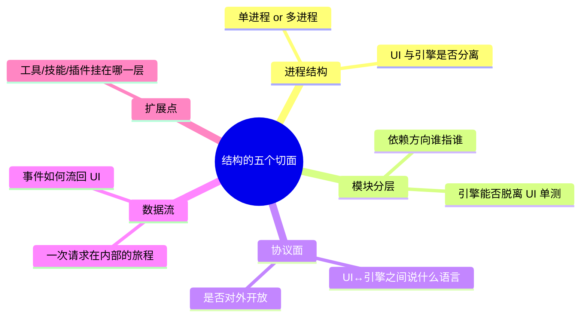
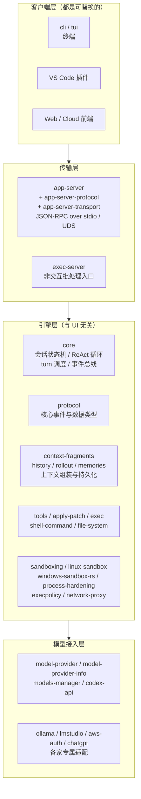
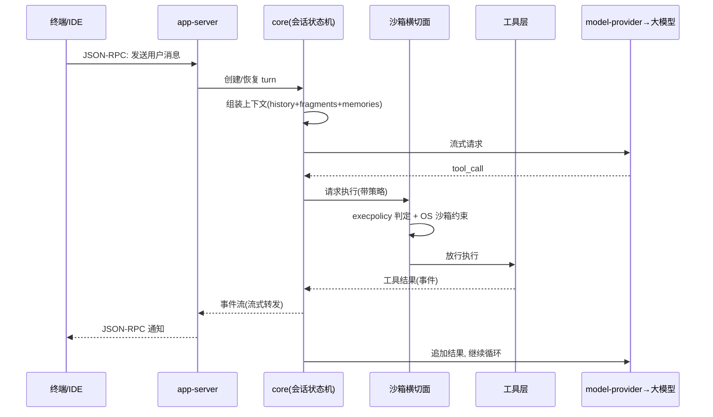
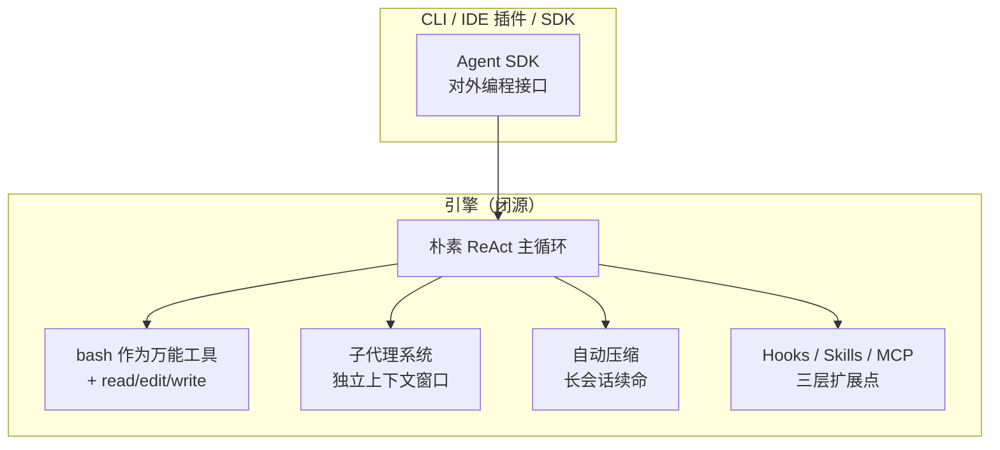
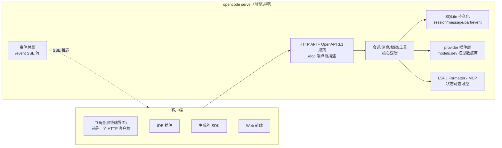
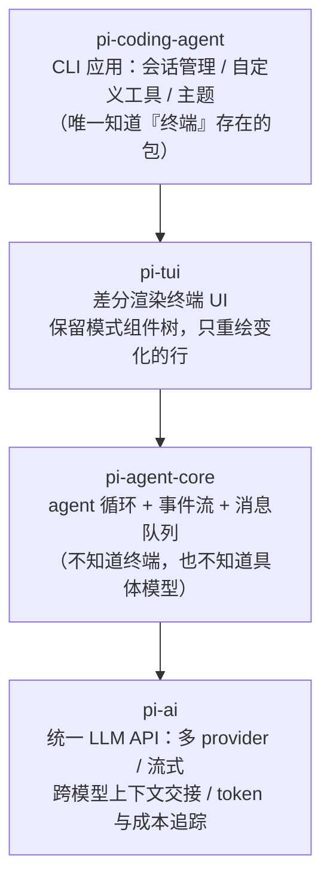
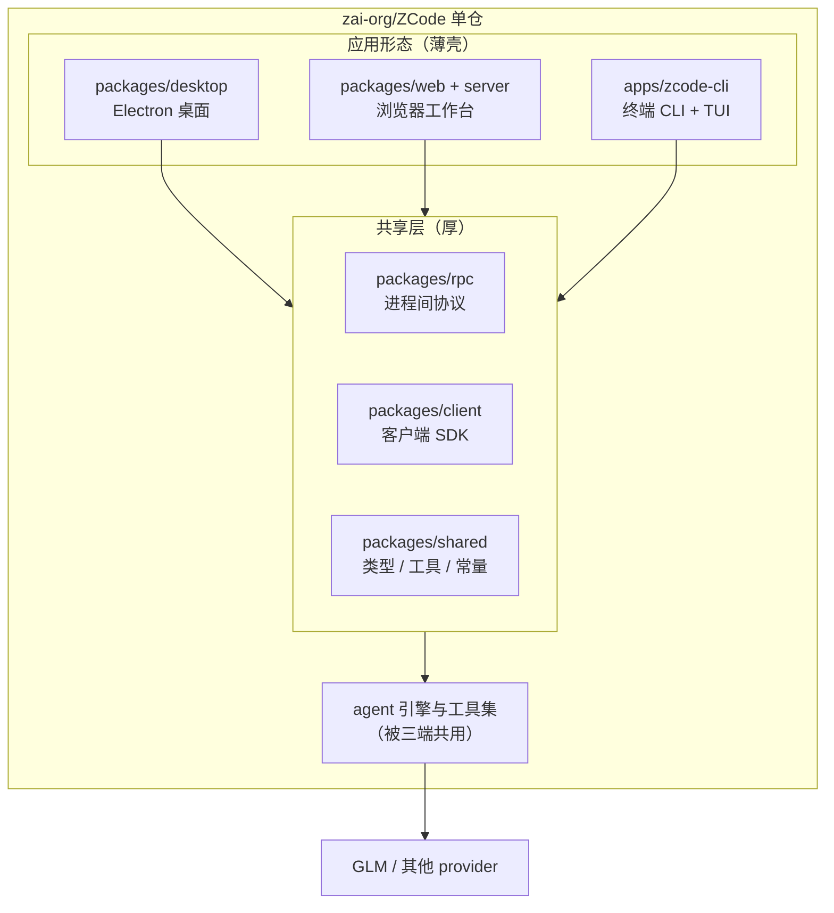
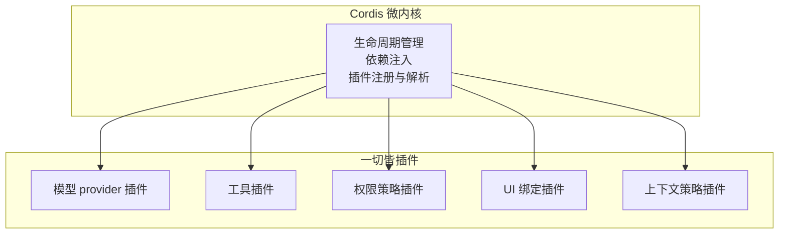
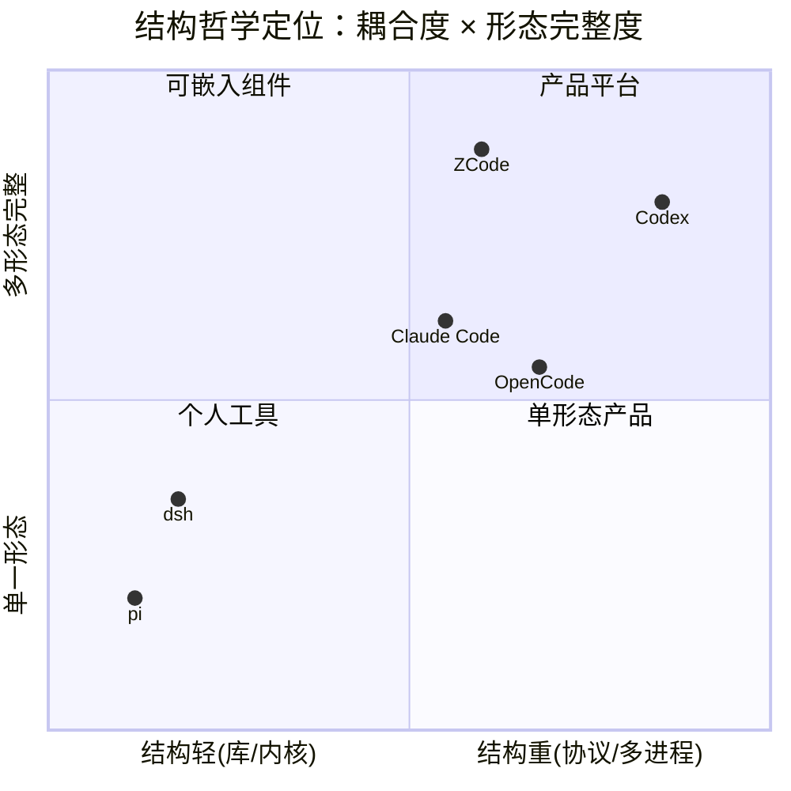

# 编码 Agent 结构对比解析：Codex / Claude Code / OpenCode / pi / ZCode / dsh

> 本文是《如何做一个好的编码 Agent》的姊妹篇。上一篇回答"做什么、怎么选、怎么升级"，这一篇只回答一个问题：**这些工具的"结构"到底长什么样**——模块怎么切、边界在哪、数据怎么流、协议怎么定、依赖朝哪个方向指。
>
> 阅读方式：可以只看每节开头的结构图和结尾的"结构点评"，需要细节再展开正文。

---

## 0. 先统一术语：什么是"结构"

谈一个编码 Agent 的结构，我们看五个切面，后文所有产品都按这五切面拆：

这五切面比"功能列表"更能决定一个产品的天花板：功能可以补，结构错了补不动。

---

## 1. Codex：进程与协议驱动的产品级结构

Codex 是六家里结构最"重"的，也是最值得逐层拆的。它的 Rust workspace（codex-rs）目前约 120 个 crate，但真正的骨架只有少数几根柱子，其余都是围绕柱子的功能件。

### 1.1 分层结构

### 1.2 结构上的四个关键决策

**① 协议与引擎分离，且协议独立成 crate。** `app-server-protocol` 只放消息类型，不含逻辑；`app-server` 负责把 JSON-RPC 请求翻译成对 core 的调用。这意味着 IDE 插件、终端、云端可以共享同一份协议定义，谁实现谁接入，引擎本身完全不知道 UI 的存在。

**② 沙箱不是一个模块，是一层横切面。** Codex 把安全拆成 `sandboxing`（策略）+ `linux-sandbox`（Landlock/bwrap）+ `windows-sandbox-rs` + `process-hardening` + `execpolicy`（命令策略规则）+ `network-proxy`（联网白名单）一整组 crate。工具层发出的每一次执行，都穿过这层横切面。**结构含义：安全不是"某个 if 判断"，而是数据流上必经的一段管道。**

**③ 上下文是显式数据，不是隐式字符串拼接。** `history`、`rollout`、`memories`、`context-fragments` 各自独立，上下文组装是一条可追踪的流水线。会话压缩、回放（rollout 重放）、跨会话记忆都有独立的存储和类型。

**④ 多入口同源。** `app-server`（交互式）、`exec-server`（一次性批处理）、`cloud-tasks`（云端委派）都指向同一个 core。这就是"一份引擎、三种形态"的结构基础——上一篇说的"agent 循环贴近工具执行环境"，落到结构上就是**引擎做成库，部署形态做成薄壳**。

### 1.3 一次请求的数据流

**结构点评**：Codex 证明了"重结构"的价值——120 个 crate 换来的是任何一端（CLI/IDE/云）接入都只需实现协议，安全、上下文、模型接入都有独立可替换的接缝。代价是复杂度高，个人开发者读源码容易被淹没。

---

## 2. Claude Code：结构不可见，但接口暴露了结构

Claude Code 闭源，但它的 Agent SDK 和分发产物暴露出的结构，与 Codex 惊人地一致——这是"殊途同归"最有力的证据。

### 2.1 可推断的结构

### 2.2 结构上的两个独特决策

**① 子代理是一等公民，不是插件。** Claude Code 的子代理拥有**独立的上下文窗口**，主代理只拿到子代理的最终结论。这在结构上意味着：会话不是一棵树，而是一片"上下文隔离的森林"，每个子代理是一次完整的、可回收的上下文分配。这是它长任务能力最强的结构根源。

**② 扩展点分三层，挂在不同位置。** Hooks（在工具调用前后插入确定性脚本）、Skills（按需加载的领域知识包）、MCP（外部工具协议）——三层分别对应"改行为、加知识、接外部"，互不混用。相比把一切都塞进 MCP 的设计，这种分层让每种扩展的成本和权限都清晰。

**结构点评**：Claude Code 的结构思想是"主循环极简 + 扩展点分层 + 子代理隔离上下文"。它的问题不在结构，在于**结构不可见**：系统提示词和工具定义随版本静默变化，用户无法审计也无法锁定，这是闭源 harness 的结构性缺陷。

---

## 3. OpenCode：HTTP 客户端/服务端结构

OpenCode 把"UI 与引擎分离"走到了和 Codex 不同的方向：不用 stdio 上的 JSON-RPC，而是**引擎即 HTTP 服务器**，一切皆可 REST。

### 3.1 结构

### 3.2 结构上的三个关键决策

**① 自描述协议（OpenAPI）取代手写协议文档。** 服务器暴露 `/doc` 端点返回完整 OpenAPI 3.1 规范，客户端 SDK 由规范**生成**而非手写。对比 Codex 手写 `app-server-protocol`，OpenCode 用"规范即代码"省掉了协议同步的成本——这是 HTTP 路线的结构红利。

**② 一切皆资源。** 会话、消息、待办、diff、权限、LSP 状态、MCP 状态、甚至 TUI 本身（`/tui/append-prompt` 等端点可以远程驱动终端界面）全部暴露为 REST 资源。这意味着**任何第三方都能完整地遥控一个 OpenCode 实例**，可编程性是六家里最强的。

**③ 状态全量落库 + SSE 广播。** 会话状态持久化在 SQLite，UI 通过 `/event` 的 SSE 流订阅变更。这是典型的"服务端持有真相，客户端是投影"结构。

**结构点评**：HTTP C/S 结构让 OpenCode 天然支持远程、多客户端、程序化集成，但也带来两个结构性代价：一是多了一层网络序列化，本地场景下比 stdio 方案重；二是**事件全量落库**导致 SQLite 膨胀（实际使用中达数 GB），这是"状态全持久化"结构决策的直接副作用。

---

## 4. pi：库分层结构，没有"服务"

pi 是六家里结构最特别的：**它根本没有服务端，也没有协议层**——它是一组可以直接 import 的库。这在结构上是对"所有 harness 都做成了服务"的反向回答。

### 4.1 四包分层（严格的单向依赖）

依赖方向严格单向：应用层 → UI 层 → 循环层 → 模型层。每一层都可以单独 import 进你自己的程序——想自建 UI？只依赖 `pi-agent-core` 和 `pi-ai` 即可，循环逻辑你一行不用写。

### 4.2 结构上的三个关键决策

**① 用"库分层"替代"进程分离"。** Codex/OpenCode 用进程边界实现可替换 UI，pi 用包边界实现同一件事。省掉了协议、序列化、进程管理的全部成本，代价是**没法远程、没法多客户端**——这是有意识的取舍，不是缺陷。

**② 跨模型上下文交接是模型层的职责。** pi-ai 负责把 Claude 的 thinking 痕迹转成 `<thinking>` 标签文本，让会话中途切到 GPT/Gemini 时思维链不丢。注意这个设计的位置：**它放在模型接入层，而不是循环层**——因为只有模型层最懂各家 provider 的消息格式差异。

**③ 工具结果双通道。** 每个工具返回两份数据：给模型的文本 + 给 UI 的结构化对象。结构上这是"同一次执行，两个消费者"，避免了 UI 反向解析模型文本的脆弱耦合。

**结构点评**：pi 证明了"结构轻"的力量——四个包、无服务、无协议，一个人能读懂全部源码，二次开发只需 import。它的短板（无子代理、无压缩、长任务弱）也恰恰是结构性的：没有上下文隔离机制，长任务自然撑不住。**结构决定能力上限，pi 是这句话最干净的例证。**

---

## 5. ZCode：单仓多端的 monorepo 结构

ZCode 的结构创新不在引擎内部，而在**仓库组织**：用 monorepo 让三种产品形态共享同一套运行时。

### 5.1 结构

### 5.2 结构上的两个关键决策

**① 薄壳厚共享。** 三个端的代码量都很薄，真正的逻辑全在共享层。桌面端管窗口、Web 端管远程连接、CLI 管终端渲染，但会话、工具、权限、模型接入只有一份。这和 Codex 的"引擎成库、形态成壳"是同一思想，只是 Codex 用进程协议实现，ZCode 用 monorepo 包共享实现。

**② RPC 层独立于任何一端。** `packages/rpc` 是独立的协议包，桌面端的 Electron 主进程与渲染进程、Web 端的前后端，都通过它通信。这让"远程工作区"（SSH/WSL 连到另一台机器跑 agent）成为结构的自然延伸——反正 UI 和引擎之间本来就是 RPC，把 RPC 的传输从本地换成 SSH 即可。

**结构点评**：ZCode 回答了"一个团队如何同时维护桌面/Web/终端三个产品"——答案是**让三端在结构上不可能产生逻辑分叉**。代价是仓库庞大，且引擎为 GLM 深度优化，模型无关性让位于形态完整性。

---

## 6. dsh（DeepSeek Harness）：插件内核结构

dsh 走的是和其他五家都不同的路：**没有一个"引擎主体"，只有一个微内核 + 插件注册机制**。

### 6.1 结构

### 6.2 结构上的核心决策

**能力不内置，全部外挂。** 其他产品是"引擎提供核心能力，插件补充边缘能力"；dsh 是"内核只提供组合机制，能力全部由插件提供"。想换权限模型？换一个插件。想换上下文压缩策略？换一个插件。引擎本身没有任何固执的立场。

**结构点评**：这是可组合性的极致，也是"结构即研究"的路线——它探索的问题是"harness 还能怎么组织"，而非"如何最快做出生产可用的产品"。代价同样结构性：没有默认立场意味着每个使用者都要自己做大量组装决策，且 developer preview 阶段接口不稳定。**它是给研究者的乐高，不是给用户的产品。**

---

## 7. 六家结构总对比

### 7.1 五切面总表

| 切面 | Codex | Claude Code | OpenCode | pi | ZCode | dsh |
|---|---|---|---|---|---|---|
| **进程结构** | 引擎独立进程，UI 经 stdio 连入 | 本地进程+SDK | 引擎即 HTTP 服务器 | **无服务，纯库** | 三端薄壳+共享引擎 | 内核+插件进程内组合 |
| **分层方式** | ~120 crate，协议/引擎/沙箱/模型四层 | 主循环+分层扩展点 | REST 资源层+核心逻辑层 | 四包严格单向依赖 | monorepo 包分层 | 微内核+全插件 |
| **协议面** | JSON-RPC over stdio/UDS，独立协议 crate | Agent SDK（编程接口） | **HTTP+OpenAPI，自描述生成 SDK** | 无协议，直接函数调用 | 独立 RPC 包 | 插件接口 |
| **数据流** | 状态机驱动，事件流经 app-server 外流 | 主循环+子代理隔离上下文 | 服务端持真相，SSE 广播投影 | 事件流在库内传递 | 共享引擎+RPC 分流到各端 | 插件间事件编排 |
| **扩展点** | MCP + 配置 + hooks | Hooks/Skills/MCP 三层 | MCP+LSP+provider 插件 | 自定义工具（改源码级） | 共享层扩展 | **一切皆是扩展点** |
| **上下文处理** | 独立 crate 流水线（history/rollout/memories） | 自动压缩+子代理森林 | 全量落库+摘要端点 | 完全透明，手动 | 自动 | 插件决定 |
| **安全** | OS 沙箱横切面（最强） | 权限+沙箱 | 权限审批 | 默认无（YOLO） | 权限审批 | 插件决定 |

### 7.2 一张图看懂六种结构哲学

（位置为定性判断，非精确度量。）

### 7.3 三条结构规律

**规律一：UI 与引擎的分离方式，决定了产品的集成天花板。**
- 用**协议**分离（Codex/OpenCode/ZCode）→ 能长出新客户端、能远程、能被第三方集成，但要维护协议。
- 用**包**分离（pi）→ 零协议成本，二次开发最爽，但永远单进程单客户端。
- 不分离（早期工具）→ 天花板最低。

**规律二：上下文在结构里的位置，决定长任务能力。**
- 上下文是**显式数据流水线**（Codex 的独立 crate、Claude Code 的子代理隔离）→ 长任务强。
- 上下文是**循环内部的临时状态**（pi 的极简循环）→ 长任务弱。
- 想补长任务能力，先改结构（加隔离、加压缩流水线），而不是调提示词。

**规律三：安全是数据流上的管道，不是配置项。**
- Codex 把沙箱做成所有执行必经的横切面 → 最强。
- 把权限做成工具调用前的审批回调（多数产品）→ 够用但可被绕过。
- 把安全寄托在提示词里 → 等于没有。

---

## 8. 对自研的结构启示（结合 WorldBase）

WorldBase 的 harness-rs 在结构上已经是"正确答案"：core（循环/权限/子代理）+ coding（确定性策略，刻意不依赖 core）+ protocol/providers/tools + app-server 的分层，与 Codex 同构，且 coding crate 的"策略下沉"思路和 pi 把跨模型交接放进模型层一样，属于**把确定性逻辑放对位置**的好结构。

对照六家，结构层面的三个升级建议（比上一篇更聚焦"结构怎么改"）：

1. **把沙箱从"审批模块"升级为"执行横切面"**。现状 permissions 是 core 里的一个模块，建议参考 Codex 的 sandboxing 横切面结构：让工具层的每次执行在数据流上必经沙箱管道，macOS Seatbelt / Linux Landlock 作为管道内的可替换实现。这是结构调整，不是功能追加。
2. **把上下文显式化为独立流水线**。参考 Codex 的 history/rollout/memories 分 crate 思路：上下文组装、压缩、回放各自独立成模块，会话可序列化、可重放。这是长任务能力的结构前提。
3. **保持协议先行，补协议文档**。app-server 方向已对，下一步是把协议定义独立成模块并文档化（Codex 的 app-server-protocol 模式），让未来的 IDE 插件、第三方客户端有稳定接缝。

---

## 参考资料

- github.com/openai/codex —— codex-rs workspace 全部 crate 划分（一手，2026-11 现状）
- opencode.ai/docs/server —— OpenAPI 自描述协议与全部 REST 端点（一手官方文档）
- Mario Zechner: *What I learned building an opinionated and minimal coding agent* —— pi 四包分层与库结构（一手）
- github.com/zai-org/ZCode —— monorepo 包结构（一手）
- github.com/deepseek-ai/deepseek-harness —— Cordis 插件内核（一手）
- Claude Code Agent SDK 文档与公开源码分析
- WorldBase 内部：harness-rs 源码（crates/core、coding、app-server）
